# Machine Learning & Edge AI Portfolio

**HEET VINODBHAI GADHIYA** · Machine learning and embedded AI engineer

I build machine-learning systems end to end: from sensors and data collection, through model design and benchmarking, to deployment on microcontrollers with tight memory and latency budgets.

      

## Projects

<a href="projects/edge-ai-motor-monitoring/"><picture><source media="(prefers-color-scheme: dark)" srcset="projects/edge-ai-motor-monitoring/assets/viz/pipeline-dark.svg">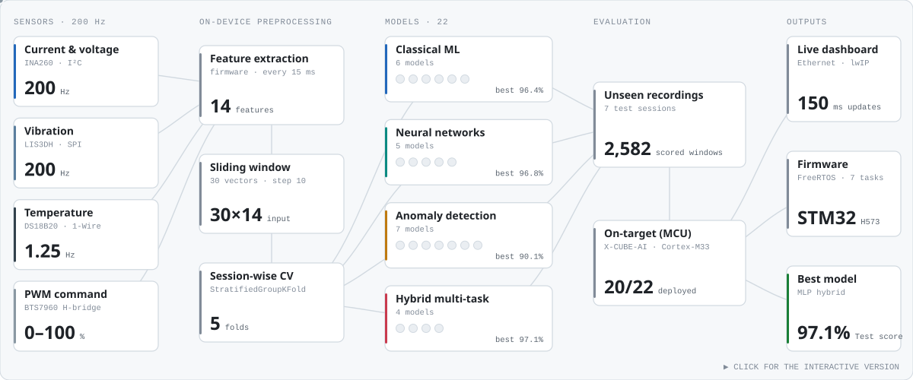</picture></a>

<a href="projects/edge-ai-motor-monitoring/"><picture><source media="(prefers-color-scheme: dark)" srcset="assets/projects/edge-ai-motor-monitoring-dark.svg">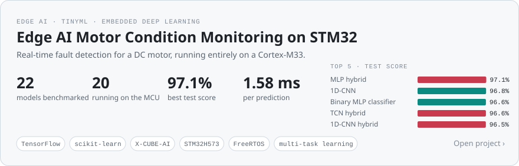</picture></a>

<a href="https://heet4226.github.io/EDGE-AI-FOR-ANOMALY-DETECTION/edge-ai-motor-monitoring/">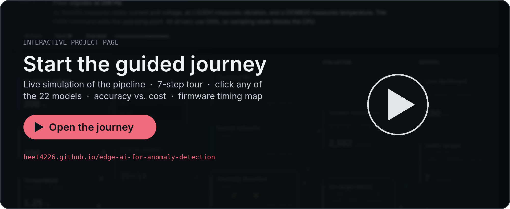</a>

<a href="projects/edge-ai-motor-monitoring/firmware/Threads/Ethernet/lwip/webpage/">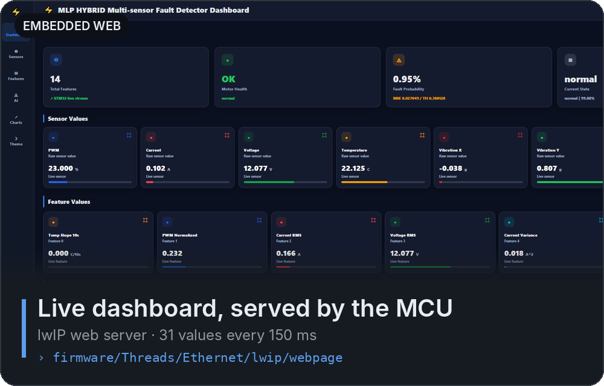</a>
<a href="projects/edge-ai-motor-monitoring/firmware/X-CUBE-AI/App/">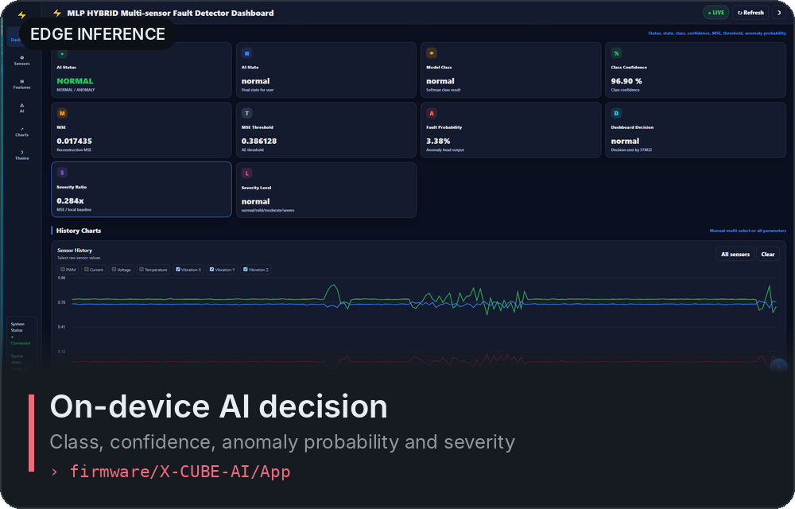</a> 
<a href="projects/edge-ai-motor-monitoring/README.md#all-models">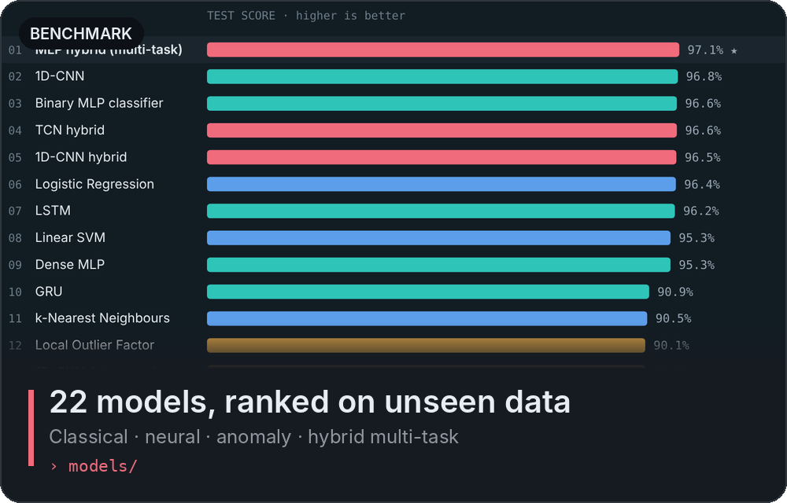</a>
<a href="projects/edge-ai-motor-monitoring/models/19_mlp_hybrid/">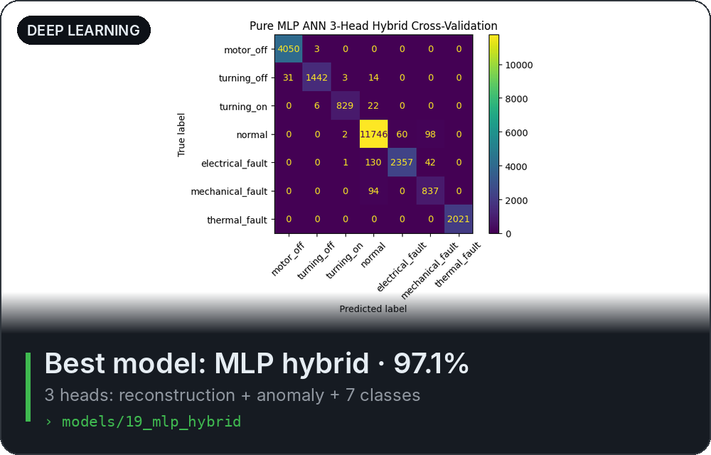</a> 
<a href="projects/edge-ai-motor-monitoring/results/model_comparison.csv">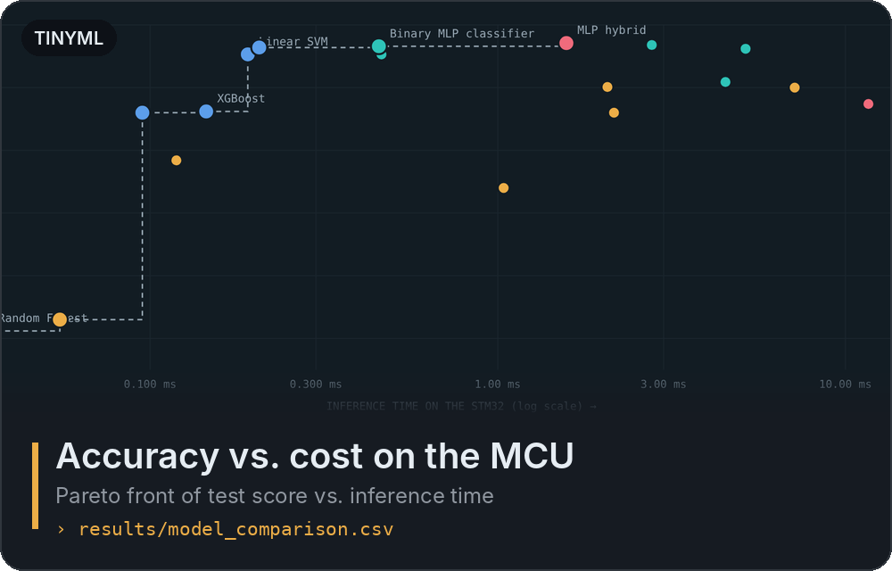</a>
<a href="projects/edge-ai-motor-monitoring/firmware/">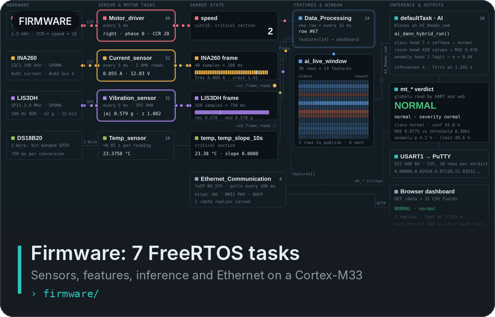</a> 
<a href="projects/edge-ai-motor-monitoring/data/">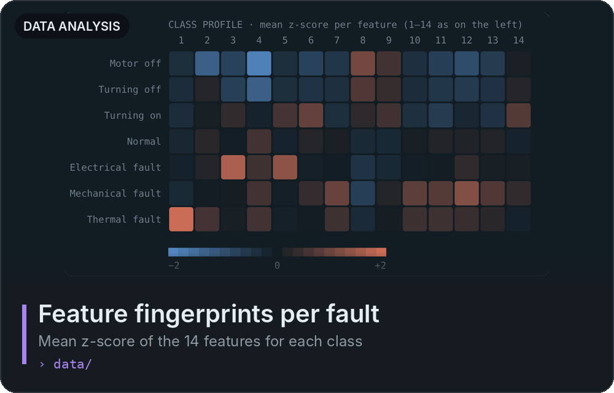</a>
<a href="projects/edge-ai-motor-monitoring/models/19_mlp_hybrid/mlp_hybrid.ipynb">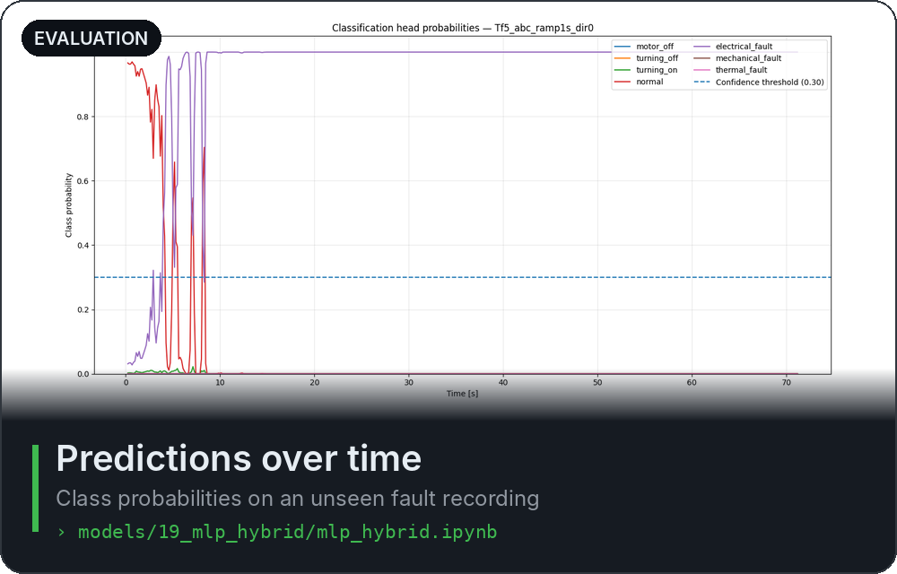</a> 

| Project | Area | Highlights |
|---|---|---|
| [**Edge AI Motor Condition Monitoring on STM32**](projects/edge-ai-motor-monitoring/) | Edge AI · TinyML · anomaly detection | 22 classical, deep, unsupervised and multi-task models benchmarked on accuracy, false alarms, memory and latency; multi-task network deployed in FreeRTOS firmware with a live web dashboard · [interactive overview](https://heet4226.github.io/EDGE-AI-FOR-ANOMALY-DETECTION/edge-ai-motor-monitoring/) |

## Skills shown here

- **Machine learning:** classical models (logistic regression, SVM, tree ensembles, k-NN), anomaly detection (isolation forest, one-class SVM, LOF, autoencoders), leakage-free evaluation with grouped cross-validation
- **Deep learning:** MLP, 1D-CNN, TCN, LSTM and GRU in TensorFlow/Keras; multi-task networks with reconstruction, anomaly and classification heads
- **Edge deployment:** TFLite and ONNX export, X-CUBE-AI conversion, on-target validation, memory and latency profiling on a Cortex-M33
- **Embedded software:** FreeRTOS multitasking, DMA-driven sensor drivers (I²C, SPI, 1-Wire), feature extraction in C, lwIP web server

## Contact

[LinkedIn](https://www.linkedin.com/in/heet-gadhiya-1758aa212)
