# Edge AI Motor Condition Monitoring on STM32

**Real-time fault detection for a DC motor, running entirely on a Cortex-M33 microcontroller.** Four sensors are turned into 14 features on the device, and a neural network classifies every 450 ms window into 7 motor states and faults. I benchmarked 22 machine-learning and deep-learning models on accuracy, false alarms, memory, and inference time, and deployed 20 of them on the STM32.

     

| | |
|---|---|
| **Best model** | MLP hybrid (multi-task): **97.1%** test score, **1.2%** false alarms, **1.58 ms** per window on the MCU |
| **Task** | 7 classes: motor off, turning on, turning off, normal, electrical fault, mechanical fault, thermal fault, plus detection of unknown anomalies |
| **Data** | 60 recording sessions, 239,367 feature vectors, 14 features from current, voltage, vibration, temperature and PWM |
| **Deployment** | 20 of 22 models converted with X-CUBE-AI and validated on the target; prediction every 150 ms |

<a href="https://heet4226.github.io/edge-ai-for-anomaly-detection/edge-ai-motor-monitoring/">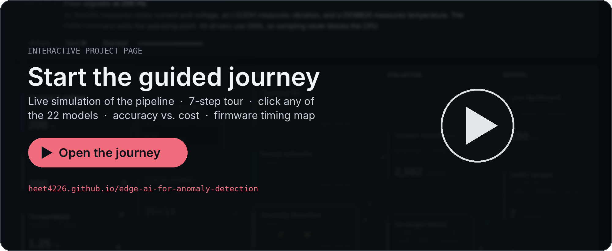</a>

## Explore the project

Click any image to open the code or results behind it.

<p>
<a href="firmware/Threads/Ethernet/lwip/webpage/">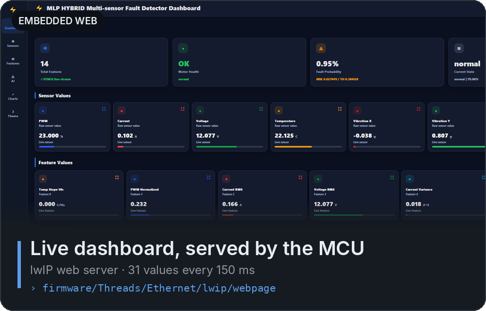</a>
<a href="firmware/X-CUBE-AI/App/">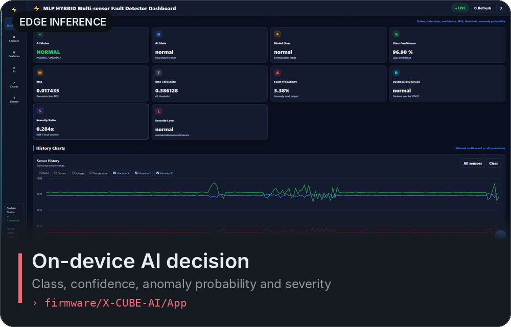</a><br>
<a href="README.md#all-models">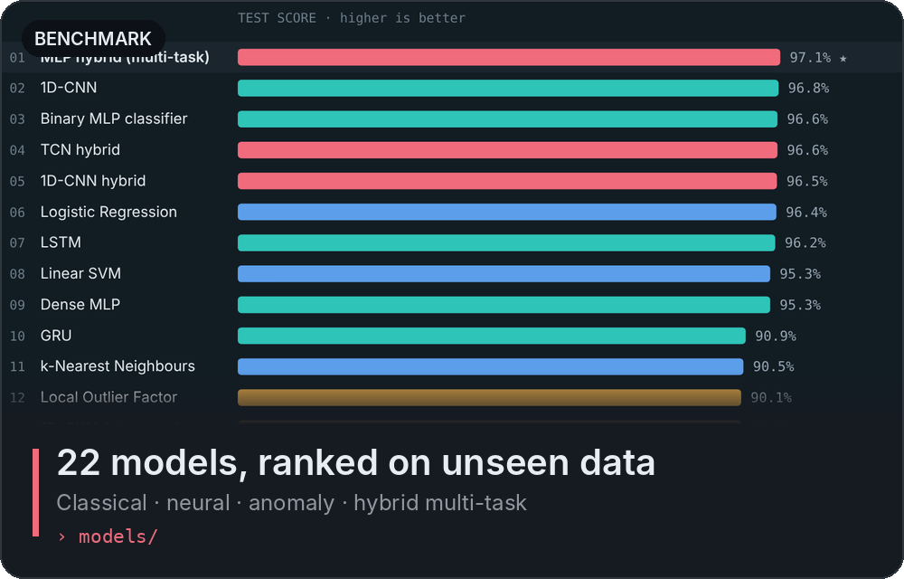</a>
<a href="models/19_mlp_hybrid/">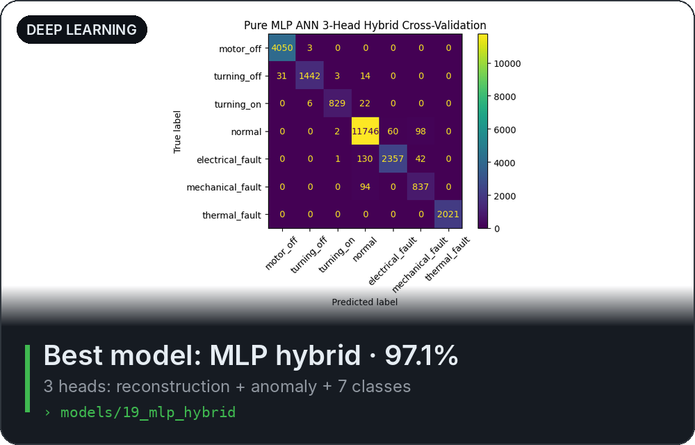</a><br>
<a href="results/model_comparison.csv">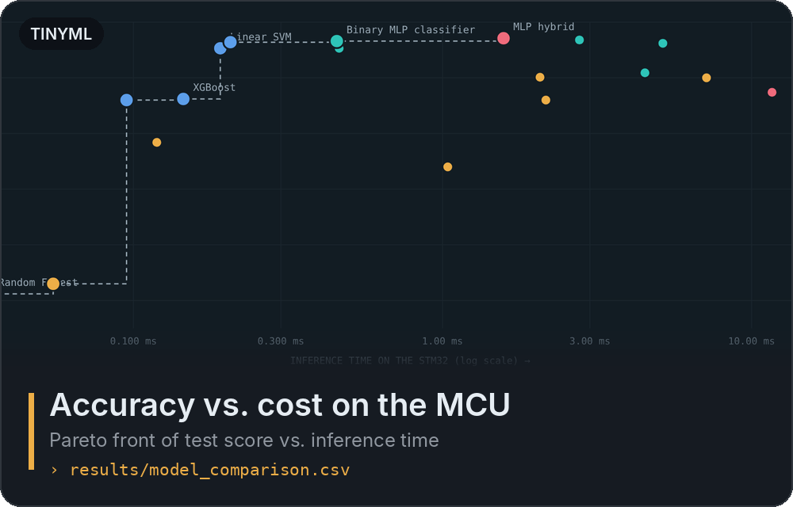</a>
<a href="firmware/">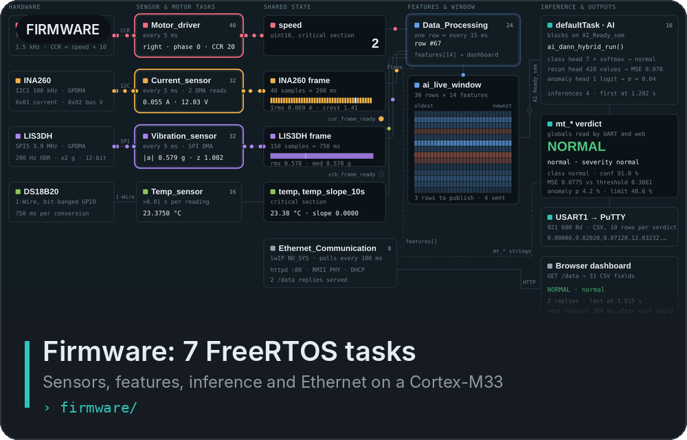</a><br>
<a href="data/">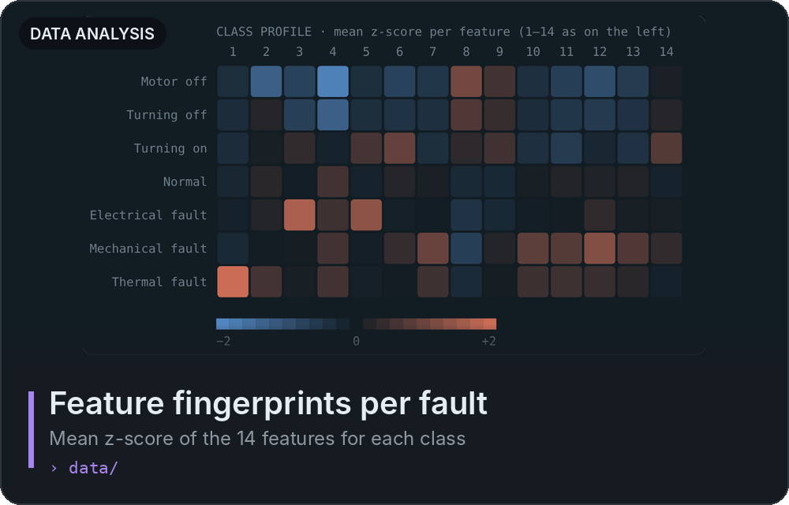</a>
<a href="models/19_mlp_hybrid/mlp_hybrid.ipynb">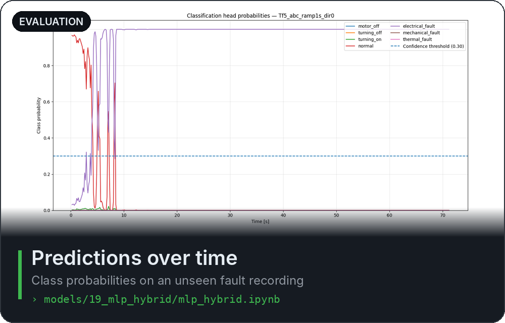</a><br>
</p>

<!-- VIZ:START (generated by tools/build_readme_visuals.py, do not edit by hand) -->
<a href="https://heet4226.github.io/edge-ai-for-anomaly-detection/edge-ai-motor-monitoring/"><picture><source media="(prefers-color-scheme: dark)" srcset="assets/viz/pipeline-dark.svg">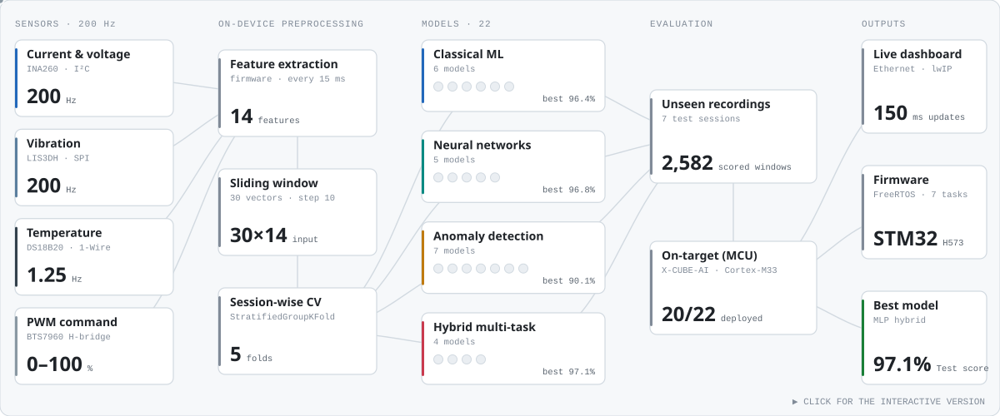</picture></a>

<p align="center"><a href="https://heet4226.github.io/edge-ai-for-anomaly-detection/edge-ai-motor-monitoring/"><b>▶ Open the interactive overview</b></a></p>

<h2 id="all-models">All 22 models, ranked</h2>

<sub>Test score = balanced accuracy of fault vs. no-fault on 7 unseen test recordings (mean of fault detection rate and 1 − false alarm rate). Click a row to open the model's notebook, metrics and plots.</sub>

<picture><source media="(prefers-color-scheme: dark)" srcset="assets/viz/lb-head-dark.svg">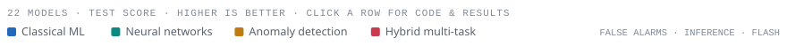</picture><br>
<a href="models/19_mlp_hybrid/"><picture><source media="(prefers-color-scheme: dark)" srcset="assets/viz/rows/19-dark.svg">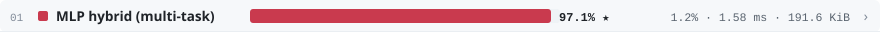</picture></a><br>
<a href="models/08_cnn_1d/"><picture><source media="(prefers-color-scheme: dark)" srcset="assets/viz/rows/08-dark.svg">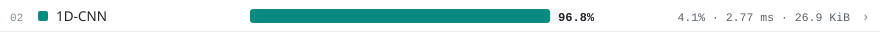</picture></a><br>
<a href="models/11_binary_mlp_classifier/"><picture><source media="(prefers-color-scheme: dark)" srcset="assets/viz/rows/11-dark.svg">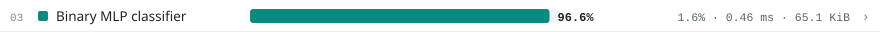</picture></a><br>
<a href="models/20_tcn_hybrid/"><picture><source media="(prefers-color-scheme: dark)" srcset="assets/viz/rows/20-dark.svg">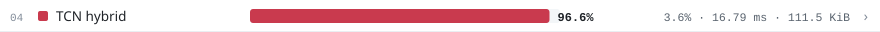</picture></a><br>
<a href="models/21_cnn_hybrid/"><picture><source media="(prefers-color-scheme: dark)" srcset="assets/viz/rows/21-dark.svg">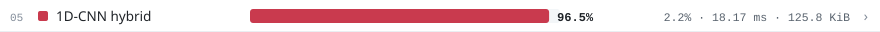</picture></a><br>
<a href="models/06_logistic_regression/"><picture><source media="(prefers-color-scheme: dark)" srcset="assets/viz/rows/06-dark.svg">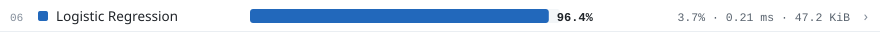</picture></a><br>
<a href="models/10_lstm/"><picture><source media="(prefers-color-scheme: dark)" srcset="assets/viz/rows/10-dark.svg">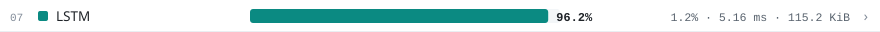</picture></a><br>
<a href="models/03_linear_svm/"><picture><source media="(prefers-color-scheme: dark)" srcset="assets/viz/rows/03-dark.svg">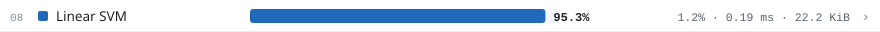</picture></a><br>
<a href="models/07_dense_mlp/"><picture><source media="(prefers-color-scheme: dark)" srcset="assets/viz/rows/07-dark.svg">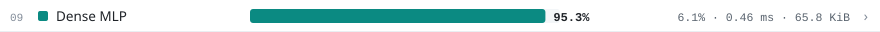</picture></a><br>
<a href="models/09_gru/"><picture><source media="(prefers-color-scheme: dark)" srcset="assets/viz/rows/09-dark.svg">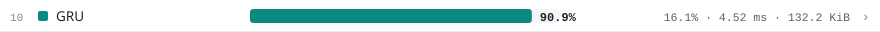</picture></a><br>
<a href="models/04_knn/"><picture><source media="(prefers-color-scheme: dark)" srcset="assets/viz/rows/04-dark.svg"></picture></a><br>
<a href="models/14_local_outlier_factor/"><picture><source media="(prefers-color-scheme: dark)" srcset="assets/viz/rows/14-dark.svg">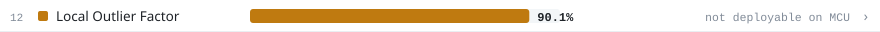</picture></a><br>
<a href="models/18_cnn_autoencoder/"><picture><source media="(prefers-color-scheme: dark)" srcset="assets/viz/rows/18-dark.svg">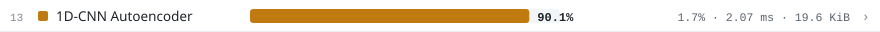</picture></a><br>
<a href="models/16_lstm_autoencoder/"><picture><source media="(prefers-color-scheme: dark)" srcset="assets/viz/rows/16-dark.svg">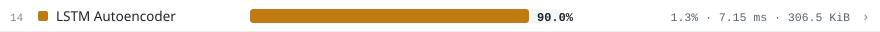</picture></a><br>
<a href="models/22_lstm_hybrid/"><picture><source media="(prefers-color-scheme: dark)" srcset="assets/viz/rows/22-dark.svg"></picture></a><br>
<a href="models/02_xgboost/"><picture><source media="(prefers-color-scheme: dark)" srcset="assets/viz/rows/02-dark.svg">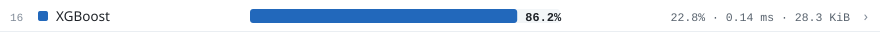</picture></a><br>
<a href="models/05_decision_tree/"><picture><source media="(prefers-color-scheme: dark)" srcset="assets/viz/rows/05-dark.svg">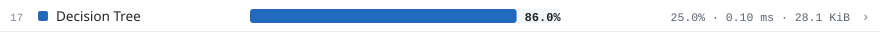</picture></a><br>
<a href="models/13_one_class_svm/"><picture><source media="(prefers-color-scheme: dark)" srcset="assets/viz/rows/13-dark.svg">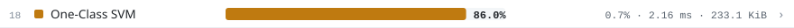</picture></a><br>
<a href="models/17_zscore_baseline/"><picture><source media="(prefers-color-scheme: dark)" srcset="assets/viz/rows/17-dark.svg">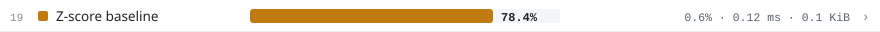</picture></a><br>
<a href="models/15_dense_autoencoder/"><picture><source media="(prefers-color-scheme: dark)" srcset="assets/viz/rows/15-dark.svg">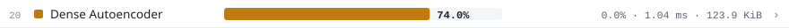</picture></a><br>
<a href="models/12_isolation_forest/"><picture><source media="(prefers-color-scheme: dark)" srcset="assets/viz/rows/12-dark.svg">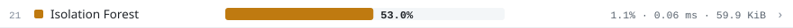</picture></a><br>
<a href="models/01_random_forest/"><picture><source media="(prefers-color-scheme: dark)" srcset="assets/viz/rows/01-dark.svg">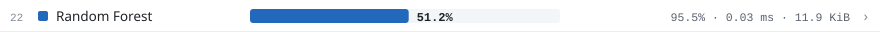</picture></a><br>

<h2>Dataset</h2>

<p>
<a href="data/"><picture><source media="(prefers-color-scheme: dark)" srcset="assets/viz/cards/data0-dark.svg">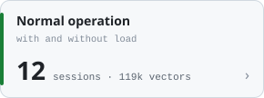</picture></a>
<a href="data/"><picture><source media="(prefers-color-scheme: dark)" srcset="assets/viz/cards/data1-dark.svg"></picture></a>
<a href="data/"><picture><source media="(prefers-color-scheme: dark)" srcset="assets/viz/cards/data2-dark.svg">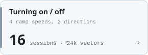</picture></a>
<a href="data/"><picture><source media="(prefers-color-scheme: dark)" srcset="assets/viz/cards/data3-dark.svg">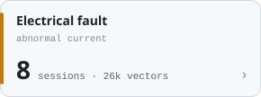</picture></a>
<a href="data/"><picture><source media="(prefers-color-scheme: dark)" srcset="assets/viz/cards/data4-dark.svg">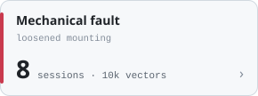</picture></a>
<a href="data/"><picture><source media="(prefers-color-scheme: dark)" srcset="assets/viz/cards/data5-dark.svg">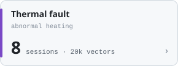</picture></a>
</p>

<h2>Hardware and software</h2>

<p>
<a href="dashboard/"><picture><source media="(prefers-color-scheme: dark)" srcset="assets/viz/cards/out0-dark.svg">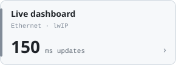</picture></a>
<a href="firmware/"><picture><source media="(prefers-color-scheme: dark)" srcset="assets/viz/cards/out1-dark.svg">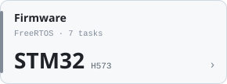</picture></a>
<a href="models/19_mlp_hybrid/"><picture><source media="(prefers-color-scheme: dark)" srcset="assets/viz/cards/best-dark.svg">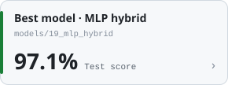</picture></a>
</p>
<!-- VIZ:END -->

## Key findings

- **The multi-task hybrid wins on unseen data.** One network with a reconstruction head, an anomaly head and a 7-class head reaches a 97.1% test score with 1.2% false alarms, in 1.58 ms and 10.6 KiB of RAM. It agreed with the reference model on 96.2% of windows in a live test on the test bench.
- **Cross-validation alone is misleading.** The decision tree, XGBoost and the GRU score highly in cross-validation, but raise 16–25% false alarms on recordings they have never seen. Only evaluating on separate recordings revealed this.
- **Simple models are strong baselines.** Logistic regression reaches 96.4% in 0.21 ms, only 0.7 points behind the best model.
- **Memory, not accuracy, rules out recurrent models.** The LSTM hybrid needs 470 KiB of RAM, which is 95% of the board's SRAM once built into the firmware. The MLP hybrid needs 10.6 KiB.
- **Unsupervised detectors almost never raise false alarms (at most 1.7%), but miss faults.** The best one, the 1D-CNN autoencoder, catches 81.8% of fault windows, which is why the hybrid combines anomaly detection with a classifier.

## How it works

1. **Sensing (200 Hz).** An INA260 measures current and voltage, an LIS3DH measures vibration, and a DS18B20 measures temperature. A BTS7960 H-bridge drives the motor with PWM.
2. **Features on the device (every 15 ms).** The firmware computes 14 features: temperature slope; PWM; RMS current and voltage; current variance and crest factor; and vibration RMS, minimum, quartiles, maximum, variance and skewness.
3. **Windowing.** 30 consecutive feature vectors (450 ms) form one model input of 30 × 14. A new window starts every 10 vectors, so a new prediction arrives every 150 ms.
4. **Training.** Every model is trained and scored with the same 5-fold `StratifiedGroupKFold`, grouped by recording session so that no session appears in both training and validation.
5. **Testing.** Every model is also scored on 7 separate test recordings, with fault detection rate, false alarm rate and class accuracy.
6. **Deployment.** Models are exported to TFLite or ONNX, converted with X-CUBE-AI, validated on the target, and run in a 7-task FreeRTOS firmware. The firmware serves a live web dashboard over Ethernet.

## Repository layout

```
edge-ai-motor-monitoring/
├── models/            22 folders: notebook, plots and a results page per model
├── results/           model_comparison.csv (all metrics) · dataset_stats.json (aggregates only)
├── firmware/          STM32H573 application code (FreeRTOS tasks, sensors, features, inference, web server)
├── dashboard/         screenshots of the live dashboard served by the MCU
├── data/              dataset description (the raw recordings are not published)
├── assets/viz/        generated README graphics
└── tools/             build_readme_visuals.py, which regenerates every chart from the CSV
```

## Reproduce

```bash
pip install -r requirements.txt
# put recordings in data/ using the layout described in data/README.md, then open any notebook:
jupyter lab models/19_mlp_hybrid/mlp_hybrid.ipynb
# rebuild the README charts after changing results/model_comparison.csv
python tools/build_readme_visuals.py
```

The raw sensor recordings are not part of this repository. The notebooks show the full training and evaluation code, and every number above is in `results/model_comparison.csv`.
