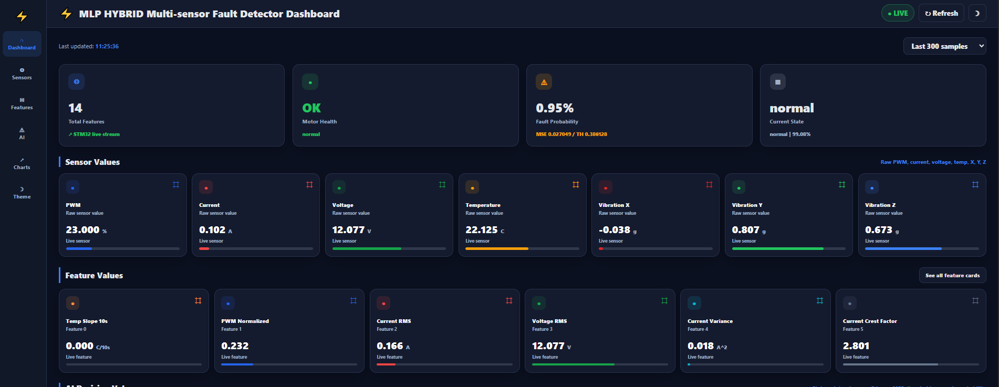
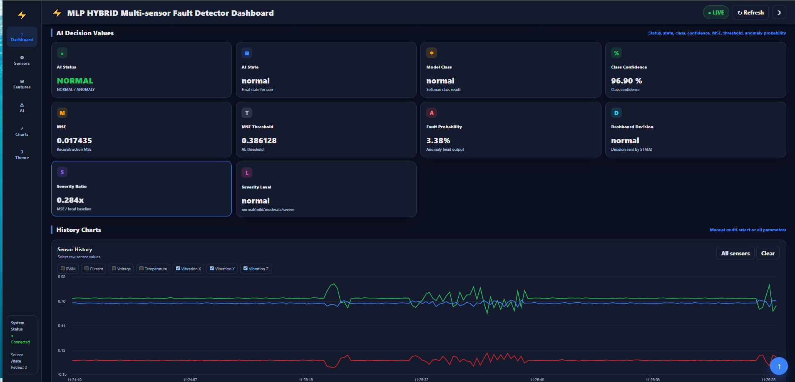
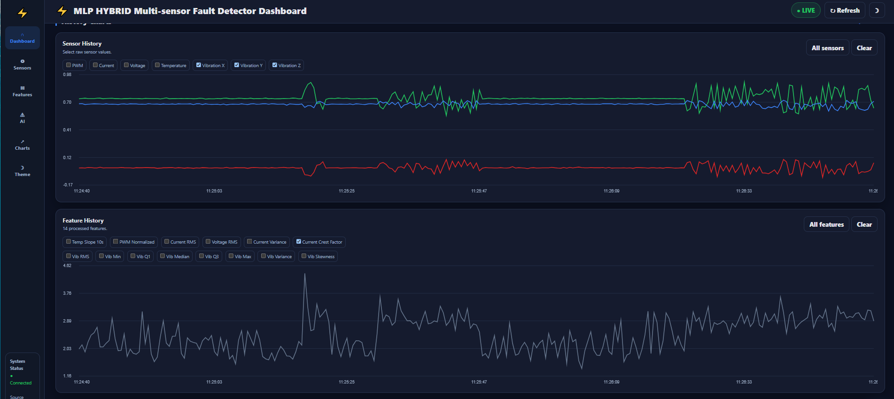
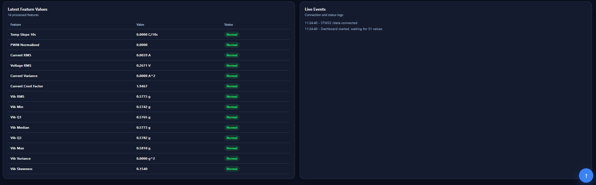

# Live dashboard

The STM32 serves this page itself over Ethernet (lwIP HTTP server, [`webpage.c`](../firmware/Threads/Ethernet/lwip/webpage/webpage.c)). The browser polls `GET /data` for a 31-field CSV: 14 features, 7 raw sensor values and 10 AI outputs (state, class, confidence, reconstruction error and threshold, fault probability, severity). The page draws the charts with hand-written canvas code and needs no external libraries.

| Overview and sensors | AI decision |
|---|---|
|  |  |
| **History charts** | **Feature table and event log** |
|  |  |
