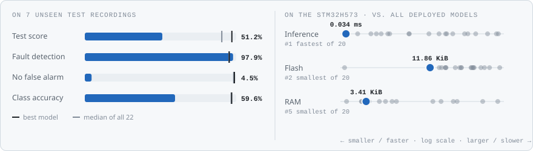
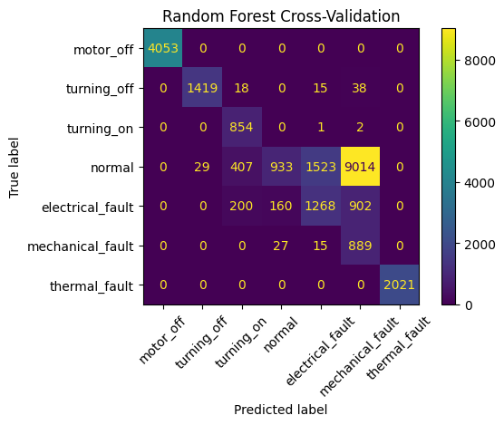
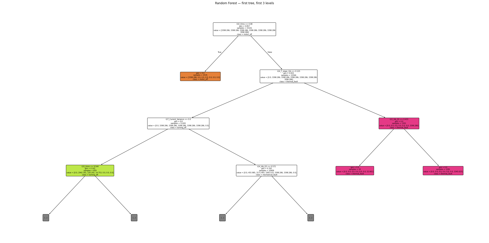
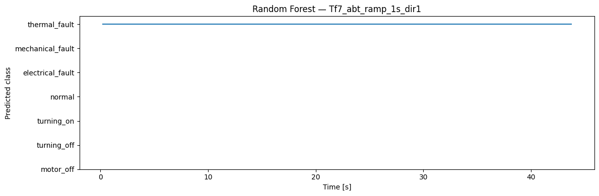

<!-- VIZ:START (generated by tools/build_readme_visuals.py, do not edit by hand) -->
# Random Forest

**Rank 22 of 22** by test score · Classical ML · runs on the STM32H573 · [← all models](../../README.md#all-models)

<picture><source media="(prefers-color-scheme: dark)" srcset="../../assets/viz/rows/01-dark.svg"></picture>

| Test score | CV macro F1 | Fault detection | False alarms | Class accuracy | Inference (STM32H573) | Flash | RAM | MACC | Training time |
|---:|---:|---:|---:|---:|---:|---:|---:|---:|---:|
| 51.2% | 63.8% | 97.9% | 95.5% | 59.6% | 0.034 ms | 11.86 KiB | 3.41 KiB | 80 | 0.6 s |

Test score = balanced accuracy of fault vs. no-fault on 7 unseen test recordings (mean of fault detection rate and 1 − false alarm rate).

### At a glance

<picture><source media="(prefers-color-scheme: dark)" srcset="../../assets/viz/model_cards/01-dark.svg"></picture>

**Model:** Shallow forest on the flattened 30×14 window

> Flags almost every running window as a fault on unseen recordings (95.5% false alarms).

### Code

- [`random_forest.ipynb`](random_forest.ipynb)

### Results from the notebook

Cross-validation and training plots, plus the notebook's manual test. The manual test plots one example recording at a time (picked in a file dialog), so they show a single condition, often the thermal-fault recording. Scores across all 7 test recordings are in the chart above.

<!-- VIZ:END -->
