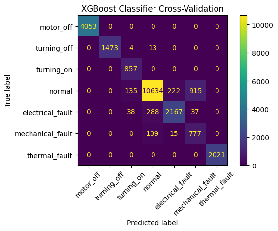
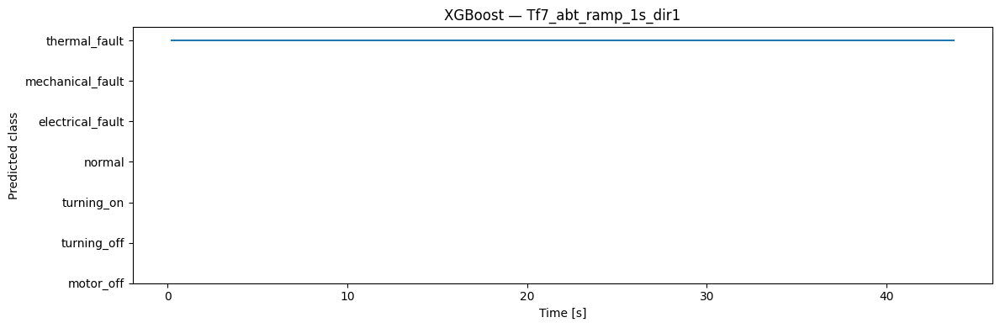

<!-- VIZ:START (generated by tools/build_readme_visuals.py, do not edit by hand) -->
# XGBoost

**Rank 16 of 22** by test score · Classical ML · runs on the STM32H573 · [← all models](../../README.md#all-models)

<picture><source media="(prefers-color-scheme: dark)" srcset="../../assets/viz/rows/02-dark.svg"></picture>

| Test score | CV macro F1 | Fault detection | False alarms | Class accuracy | Inference (STM32H573) | Flash | RAM | MACC | Training time |
|---:|---:|---:|---:|---:|---:|---:|---:|---:|---:|
| 86.2% | 89.8% | 95.2% | 22.8% | 91.3% | 0.145 ms | 28.26 KiB | 3.41 KiB | 1,061 | 11.2 s |

Test score = balanced accuracy of fault vs. no-fault on 7 unseen test recordings (mean of fault detection rate and 1 − false alarm rate).

**Model:** Small boosted-tree ensemble (few, shallow trees)

> Good in cross-validation but overfits: 22.8% false alarms on unseen recordings.

### Code

- [`xgboost.ipynb`](xgboost.ipynb)

### Results

<!-- VIZ:END -->
