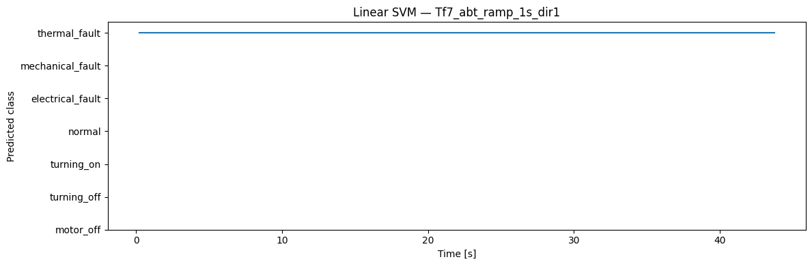

<!-- VIZ:START (generated by tools/build_readme_visuals.py, do not edit by hand) -->
# Linear SVM

**Rank 8 of 22** by test score · Classical ML · runs on the STM32H573 · [← all models](../../README.md#all-models)

<picture><source media="(prefers-color-scheme: dark)" srcset="../../assets/viz/rows/03-dark.svg"></picture>

| Test score | CV macro F1 | Fault detection | False alarms | Class accuracy | Inference (STM32H573) | Flash | RAM | MACC | Training time |
|---:|---:|---:|---:|---:|---:|---:|---:|---:|---:|
| 95.3% | 92.7% | 91.9% | 1.2% | 93.5% | 0.191 ms | 22.23 KiB | 3.19 KiB | 3,780 | 343.2 s |

Test score = balanced accuracy of fault vs. no-fault on 7 unseen test recordings (mean of fault detection rate and 1 − false alarm rate).

### At a glance

<picture><source media="(prefers-color-scheme: dark)" srcset="../../assets/viz/model_cards/03-dark.svg"></picture>

**Model:** Linear kernel, one weight vector per class

> Robust in the live test; the main confusion is at motor switch-on and switch-off.

### Code

- [`linear_svm.ipynb`](linear_svm.ipynb)

### Results from the notebook

Cross-validation and training plots, plus the notebook's manual test. The manual test plots one example recording at a time (picked in a file dialog), so they show a single condition, often the thermal-fault recording. Scores across all 7 test recordings are in the chart above.

<!-- VIZ:END -->
