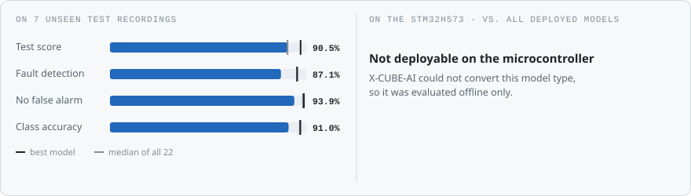
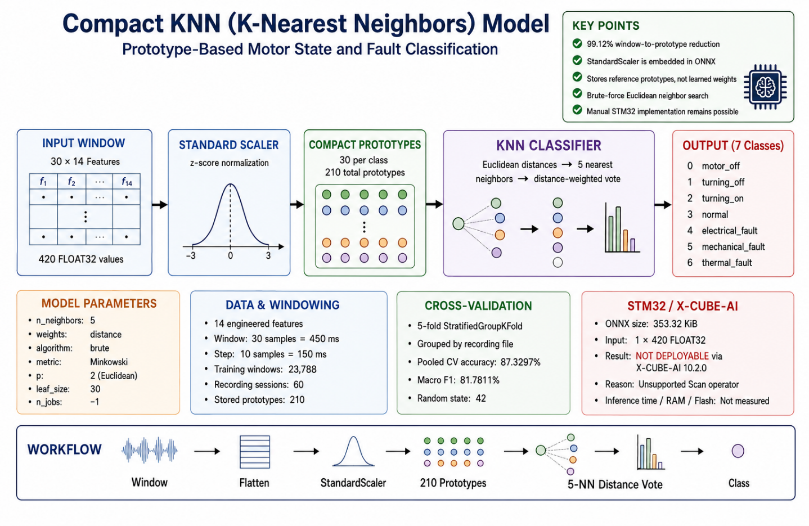
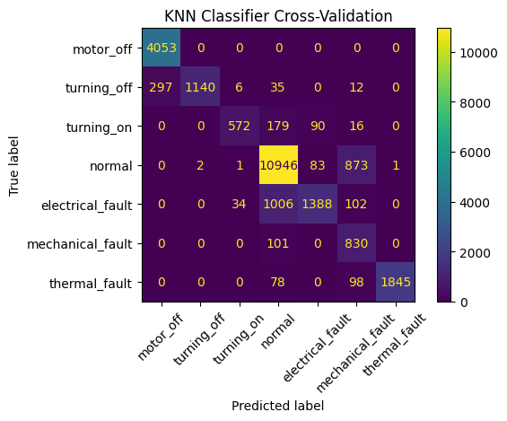
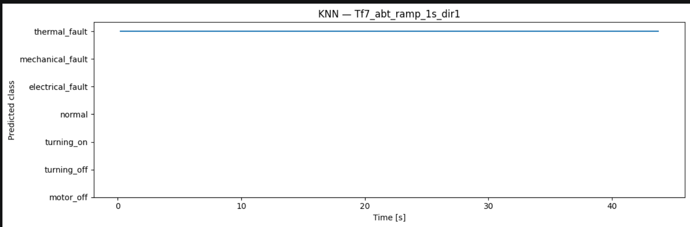
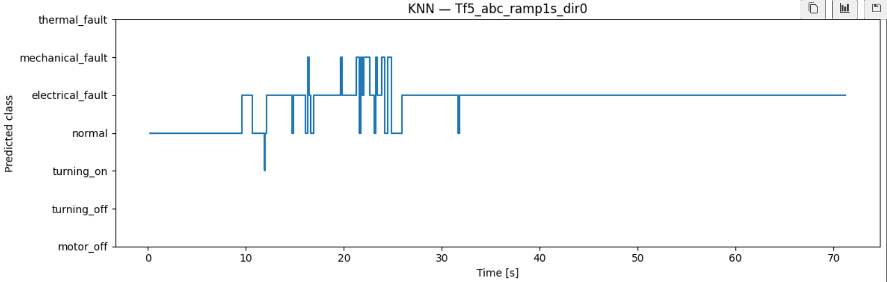
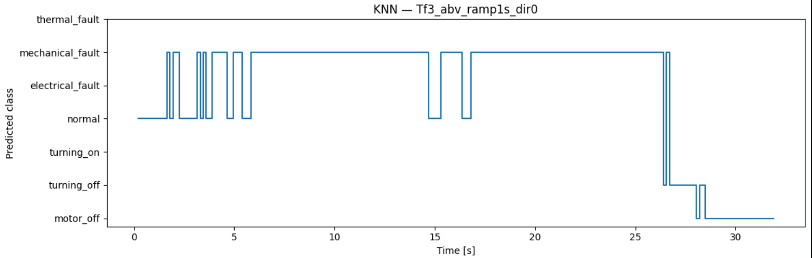

<!-- VIZ:START (generated by tools/build_readme_visuals.py, do not edit by hand) -->
# k-Nearest Neighbours

**Rank 11 of 22** by test score · Classical ML · **not deployable on the MCU** · [← all models](../../README.md#all-models)

<picture><source media="(prefers-color-scheme: dark)" srcset="../../assets/viz/rows/04-dark.svg"></picture>

| Test score | CV macro F1 | Fault detection | False alarms | Class accuracy | Training time |
|---:|---:|---:|---:|---:|---:|
| 90.5% | 81.8% | 87.1% | 6.1% | 91.0% | 346.0 s |

Test score = balanced accuracy of fault vs. no-fault on 7 unseen test recordings (mean of fault detection rate and 1 − false alarm rate).

### At a glance

<picture><source media="(prefers-color-scheme: dark)" srcset="../../assets/viz/model_cards/04-dark.svg"></picture>

**Model:** Distance-weighted vote over the stored training set

> Cannot be converted for the MCU: the model stores the whole training set (353 KiB ONNX).

### Code

- [`knn.ipynb`](knn.ipynb)

### Architecture

### Results from the notebook

Cross-validation and training plots from the notebook.

### Tests on the fault recordings

The model on the three fault recordings: Tf3 mechanical fault, Tf5 electrical fault and Tf7 thermal fault (named in each plot title).

<!-- VIZ:END -->
