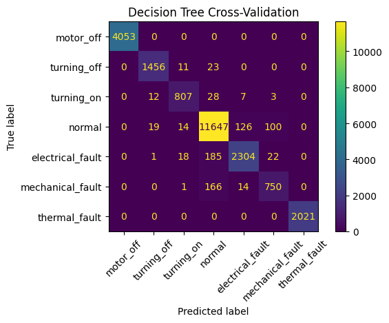
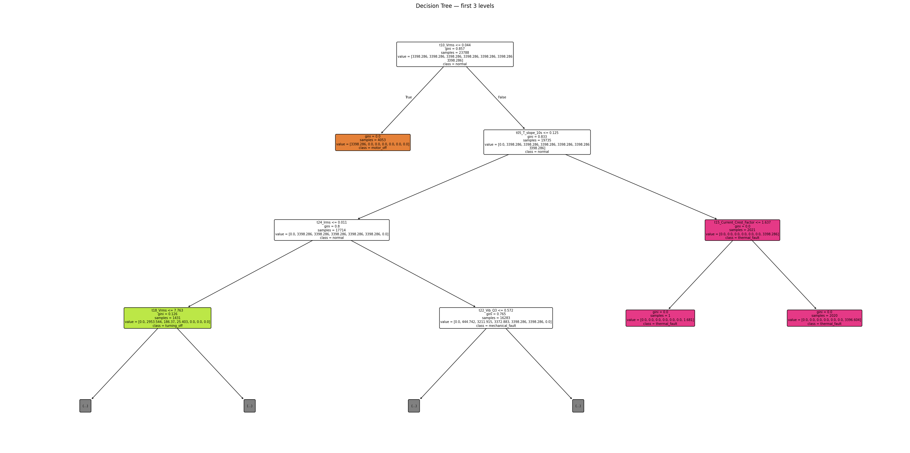
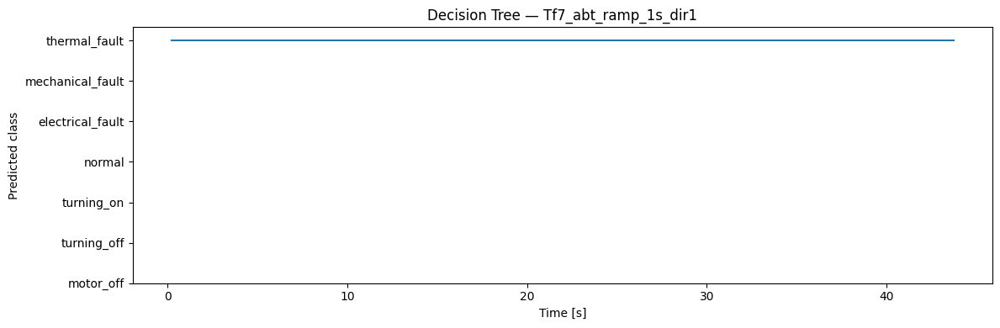

<!-- VIZ:START (generated by tools/build_readme_visuals.py, do not edit by hand) -->
# Decision Tree

**Rank 17 of 22** by test score · Classical ML · runs on the STM32H573 · [← all models](../../README.md#all-models)

<picture><source media="(prefers-color-scheme: dark)" srcset="../../assets/viz/rows/05-dark.svg"></picture>

| Test score | CV macro F1 | Fault detection | False alarms | Class accuracy | Inference (STM32H573) | Flash | RAM | MACC | Training time |
|---:|---:|---:|---:|---:|---:|---:|---:|---:|---:|
| 86.0% | 95.0% | 97.1% | 25.0% | 92.4% | 0.095 ms | 28.07 KiB | 3.65 KiB | 14 | 45.6 s |

Test score = balanced accuracy of fault vs. no-fault on 7 unseen test recordings (mean of fault detection rate and 1 − false alarm rate).

**Model:** Single shallow tree, exported as an if/else chain

> Best classical cross-validation F1, but overfits: 25% false alarms on unseen recordings.

### Code

- [`decision_tree.ipynb`](decision_tree.ipynb)

### Results

<!-- VIZ:END -->
