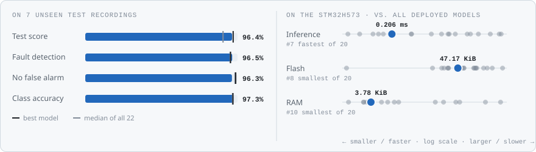
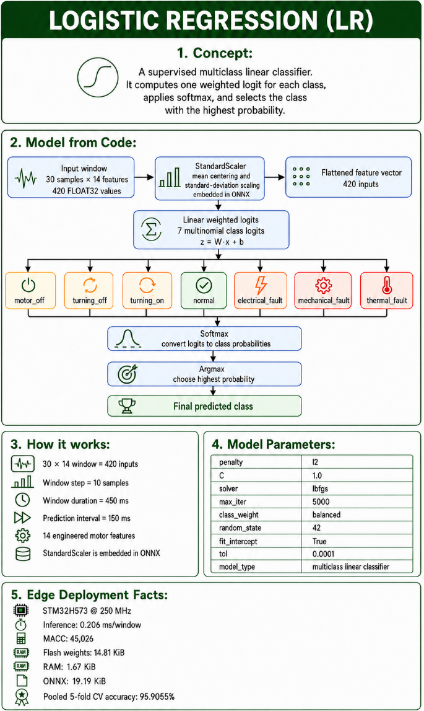
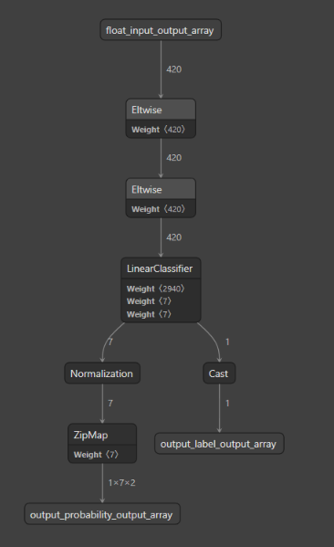
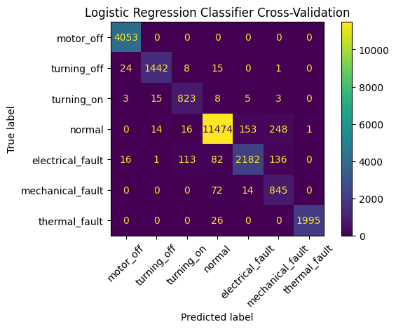
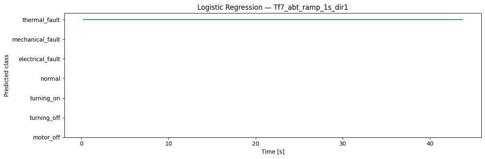
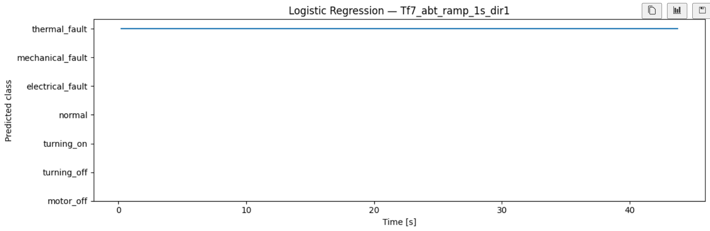
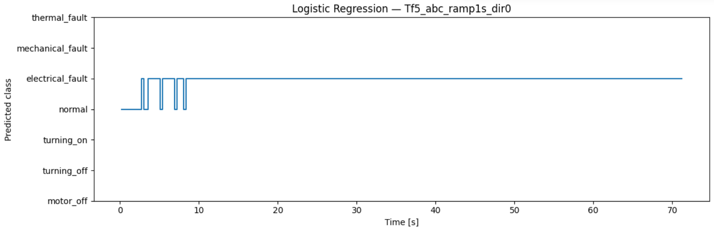
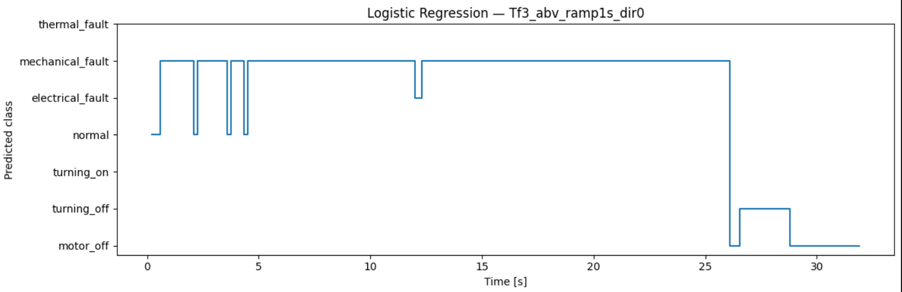

<!-- VIZ:START (generated by tools/build_readme_visuals.py, do not edit by hand) -->
# Logistic Regression

**Rank 6 of 22** by test score · Classical ML · runs on the STM32H573 · [← all models](../../README.md#all-models)

<picture><source media="(prefers-color-scheme: dark)" srcset="../../assets/viz/rows/06-dark.svg"></picture>

| Test score | CV macro F1 | Fault detection | False alarms | Class accuracy | Inference (STM32H573) | Flash | RAM | MACC | Training time |
|---:|---:|---:|---:|---:|---:|---:|---:|---:|---:|
| 96.4% | 93.1% | 96.5% | 3.7% | 97.3% | 0.206 ms | 47.17 KiB | 3.78 KiB | 45,026 | 101.3 s |

Test score = balanced accuracy of fault vs. no-fault on 7 unseen test recordings (mean of fault detection rate and 1 − false alarm rate).

### At a glance

<picture><source media="(prefers-color-scheme: dark)" srcset="../../assets/viz/model_cards/06-dark.svg"></picture>

**Model:** Multinomial logistic regression

> Best classical model on unseen data (96.4%) in 0.21 ms per window.

### Code

- [`logistic_regression.ipynb`](logistic_regression.ipynb)

### Architecture

### Results from the notebook

Cross-validation and training plots, and the notebook's manual test on one example recording (named in the plot title).

### Tests on the fault recordings

The model on the three fault recordings: Tf3 mechanical fault, Tf5 electrical fault and Tf7 thermal fault (named in each plot title).

<!-- VIZ:END -->
