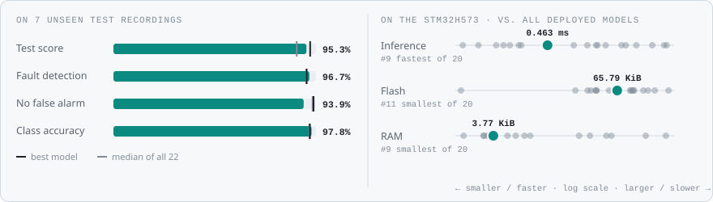
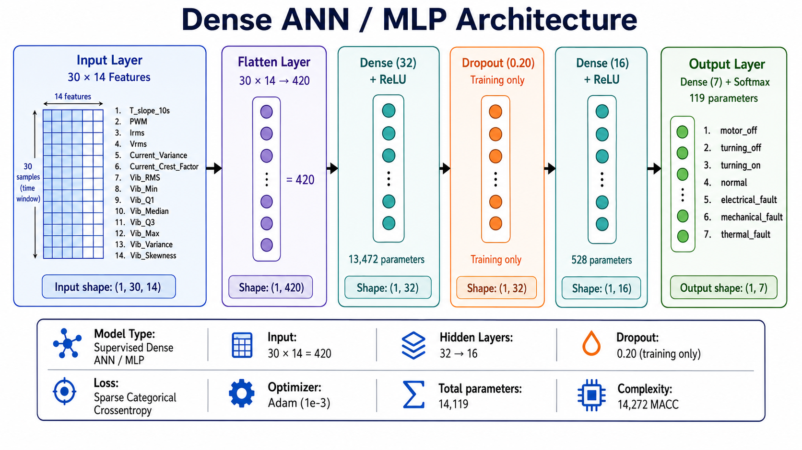
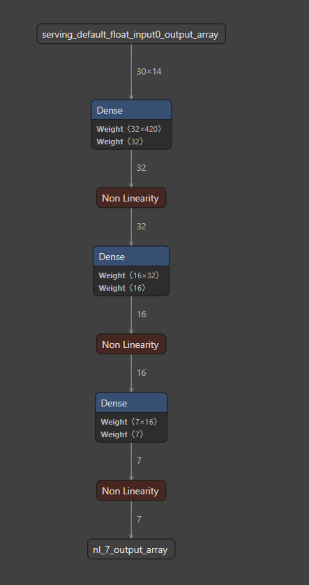
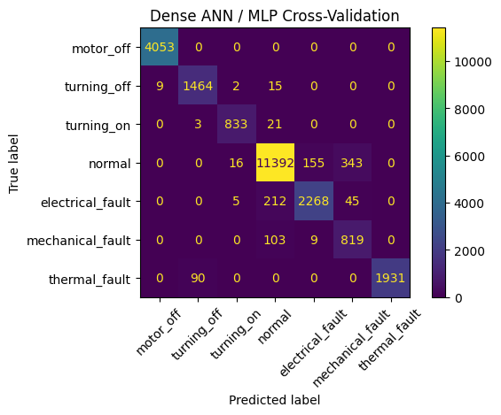
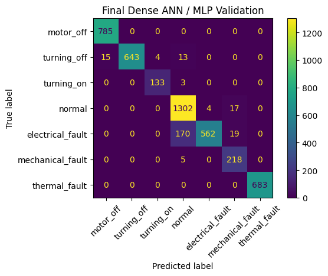
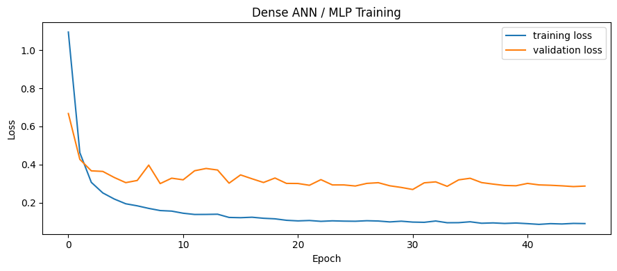
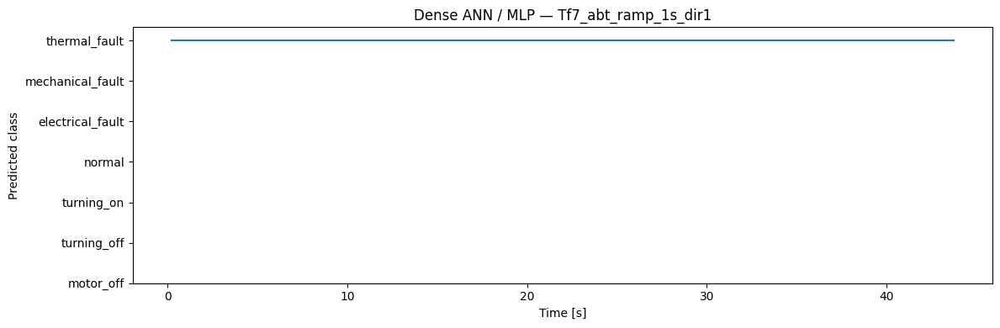
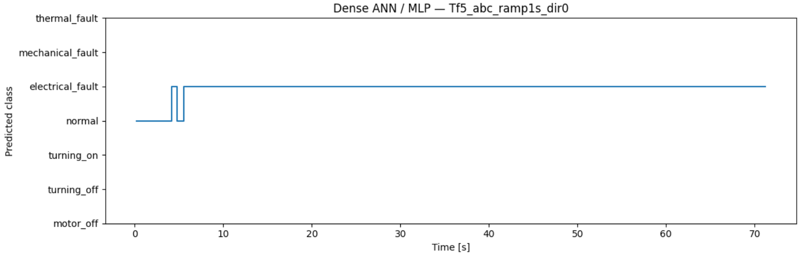
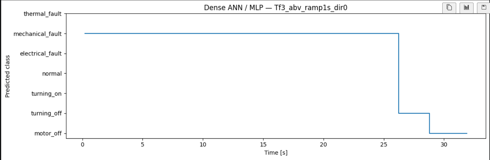
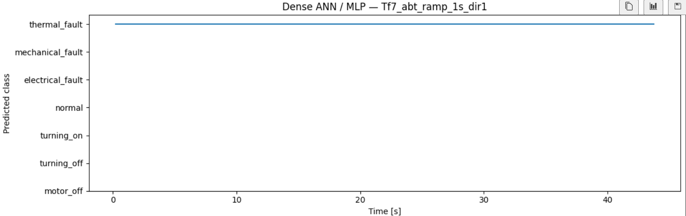

<!-- VIZ:START (generated by tools/build_readme_visuals.py, do not edit by hand) -->
# Dense MLP

**Rank 9 of 22** by test score · Neural networks · runs on the STM32H573 · [← all models](../../README.md#all-models)

<picture><source media="(prefers-color-scheme: dark)" srcset="../../assets/viz/rows/07-dark.svg"></picture>

| Test score | CV macro F1 | Fault detection | False alarms | Class accuracy | Inference (STM32H573) | Flash | RAM | MACC | Training time |
|---:|---:|---:|---:|---:|---:|---:|---:|---:|---:|
| 95.3% | 93.6% | 96.7% | 6.1% | 97.8% | 0.463 ms | 65.79 KiB | 3.77 KiB | 14,272 | 69.5 s |

Test score = balanced accuracy of fault vs. no-fault on 7 unseen test recordings (mean of fault detection rate and 1 − false alarm rate).

### At a glance

<picture><source media="(prefers-color-scheme: dark)" srcset="../../assets/viz/model_cards/07-dark.svg"></picture>

**Model:** Flatten (420) → dense layers → softmax(7)

> Small and fast (0.46 ms) with 97.8% class accuracy on unseen recordings.

### Code

- [`dense_mlp.ipynb`](dense_mlp.ipynb)

### Architecture

### Results from the notebook

Cross-validation and training plots, and the notebook's manual test on one example recording (named in the plot title).

### Tests on the fault recordings

The model on the three fault recordings: Tf3 mechanical fault, Tf5 electrical fault and Tf7 thermal fault (named in each plot title).

<!-- VIZ:END -->
