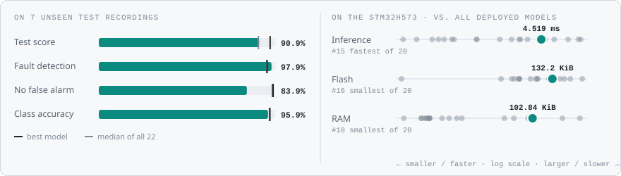
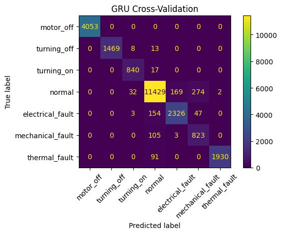
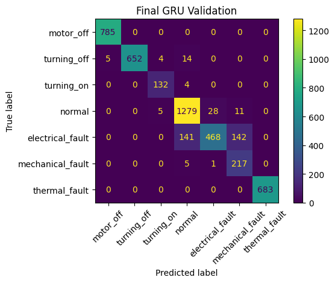
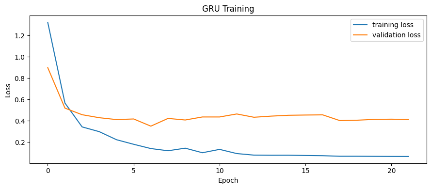
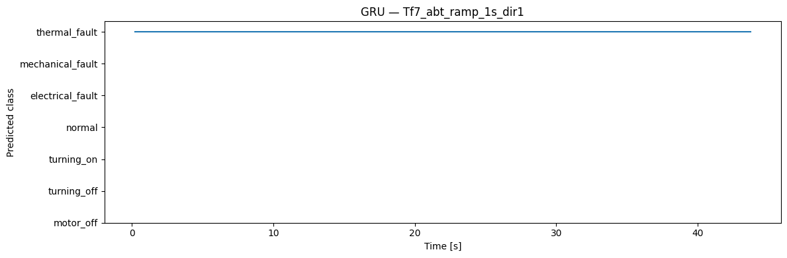

<!-- VIZ:START (generated by tools/build_readme_visuals.py, do not edit by hand) -->
# GRU

**Rank 10 of 22** by test score · Neural networks · runs on the STM32H573 · [← all models](../../README.md#all-models)

<picture><source media="(prefers-color-scheme: dark)" srcset="../../assets/viz/rows/09-dark.svg"></picture>

| Test score | CV macro F1 | Fault detection | False alarms | Class accuracy | Inference (STM32H573) | Flash | RAM | MACC | Training time |
|---:|---:|---:|---:|---:|---:|---:|---:|---:|---:|
| 90.9% | 94.5% | 97.9% | 16.1% | 95.9% | 4.519 ms | 132.20 KiB | 102.84 KiB | 63,152 | 131.5 s |

Test score = balanced accuracy of fault vs. no-fault on 7 unseen test recordings (mean of fault detection rate and 1 − false alarm rate).

### At a glance

<picture><source media="(prefers-color-scheme: dark)" srcset="../../assets/viz/model_cards/09-dark.svg"></picture>

**Model:** Single small GRU layer over 30 time steps

> Strong in cross-validation, but 16.1% false alarms on unseen recordings.

### Code

- [`gru.ipynb`](gru.ipynb)

### Results from the notebook

Cross-validation and training plots, plus the notebook's manual test. The manual test plots one example recording at a time (picked in a file dialog), so they show a single condition, often the thermal-fault recording. Scores across all 7 test recordings are in the chart above.

<!-- VIZ:END -->
