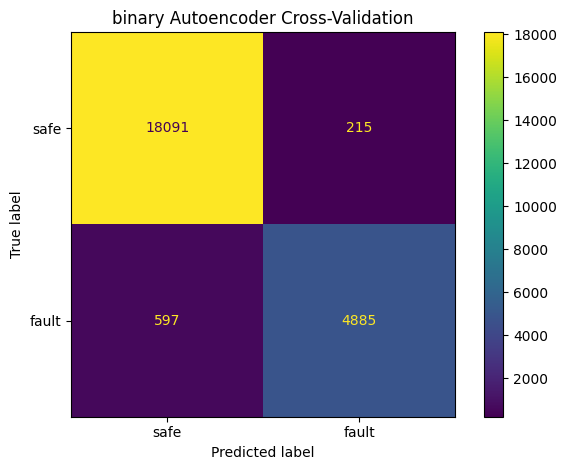
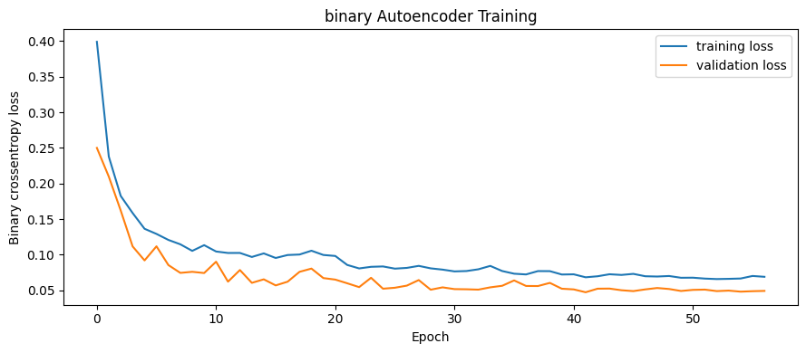
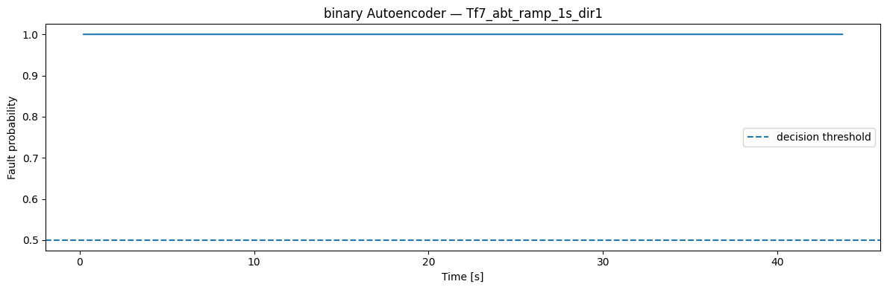

<!-- VIZ:START (generated by tools/build_readme_visuals.py, do not edit by hand) -->
# Binary MLP classifier

**Rank 3 of 22** by test score · Neural networks · runs on the STM32H573 · [← all models](../../README.md#all-models)

<picture><source media="(prefers-color-scheme: dark)" srcset="../../assets/viz/rows/11-dark.svg"></picture>

| Test score | CV macro F1 | Fault detection | False alarms | Inference (STM32H573) | Flash | RAM | MACC | Training time |
|---:|---:|---:|---:|---:|---:|---:|---:|---:|
| 96.6% | 92.3% | 94.9% | 1.6% | 0.455 ms | 65.09 KiB | 3.76 KiB | 14,075 | 52.3 s |

Test score = balanced accuracy of fault vs. no-fault on 7 unseen test recordings (mean of fault detection rate and 1 − false alarm rate).

**Model:** Dense network with a single safe-vs-fault output

> 96.6% test score with 1.6% false alarms; reports safe vs. fault only.

### Code

- [`binary_mlp_classifier.ipynb`](binary_mlp_classifier.ipynb)

### Results

<!-- VIZ:END -->
