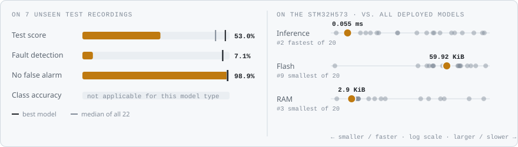
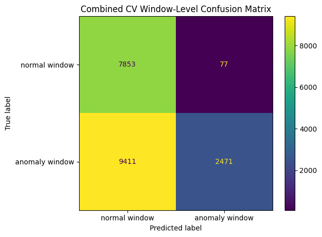
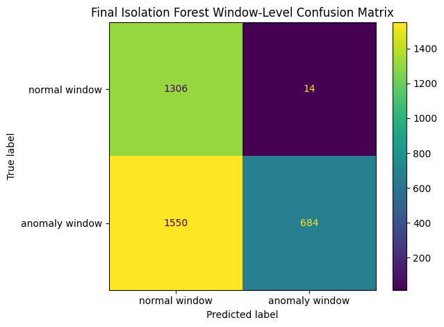
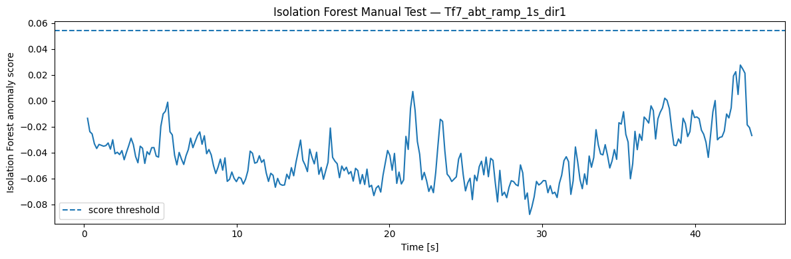

<!-- VIZ:START (generated by tools/build_readme_visuals.py, do not edit by hand) -->
# Isolation Forest

**Rank 21 of 22** by test score · Anomaly detection · runs on the STM32H573 · [← all models](../../README.md#all-models)

<picture><source media="(prefers-color-scheme: dark)" srcset="../../assets/viz/rows/12-dark.svg"></picture>

| Test score | CV macro F1 | Fault detection | False alarms | Inference (STM32H573) | Flash | RAM | MACC | Training time |
|---:|---:|---:|---:|---:|---:|---:|---:|---:|
| 53.0% | 34.2% | 7.1% | 1.1% | 0.055 ms | 59.92 KiB | 2.90 KiB | 2,628 | 0.5 s |

Test score = balanced accuracy of fault vs. no-fault on 7 unseen test recordings (mean of fault detection rate and 1 − false alarm rate).

### At a glance

<picture><source media="(prefers-color-scheme: dark)" srcset="../../assets/viz/model_cards/12-dark.svg"></picture>

**Model:** Small random-tree ensemble, trained on normal data only

> Detects only 7.1% of the fault windows.

### Code

- [`isolation_forest.ipynb`](isolation_forest.ipynb)

### Results from the notebook

Cross-validation and training plots, plus the notebook's manual test. The manual test plots one example recording at a time (picked in a file dialog), so they show a single condition, often the thermal-fault recording. Scores across all 7 test recordings are in the chart above.

<!-- VIZ:END -->
