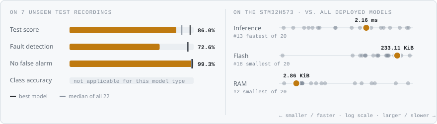
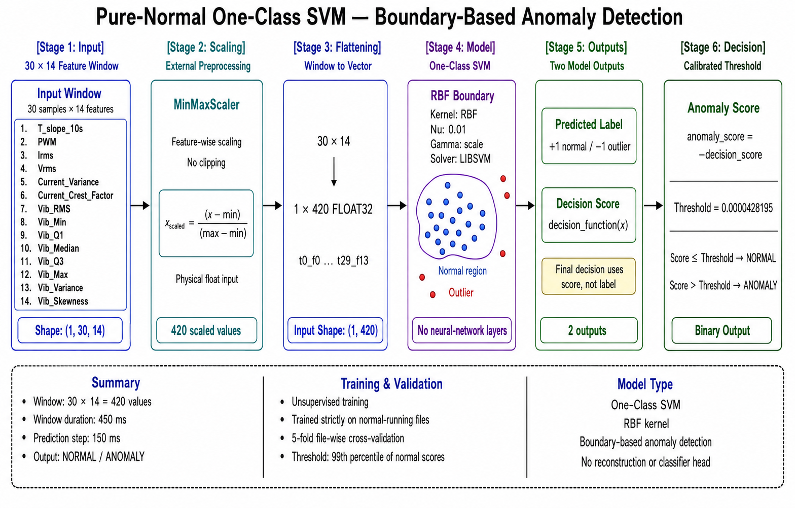
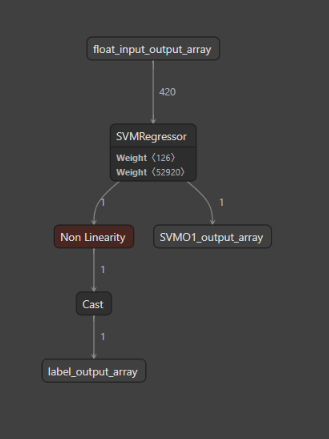
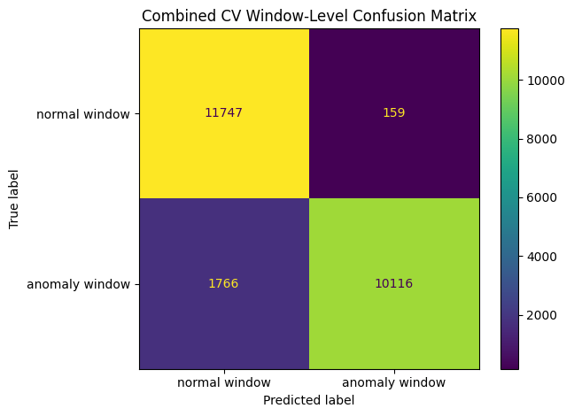
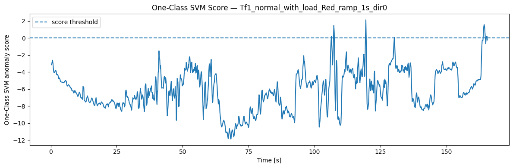
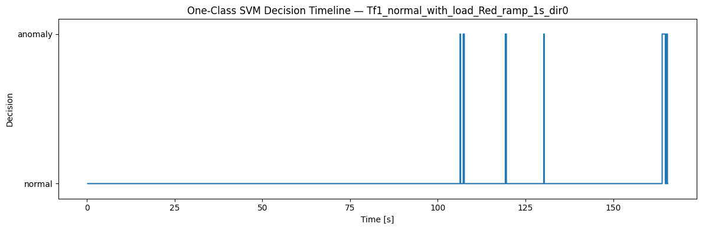
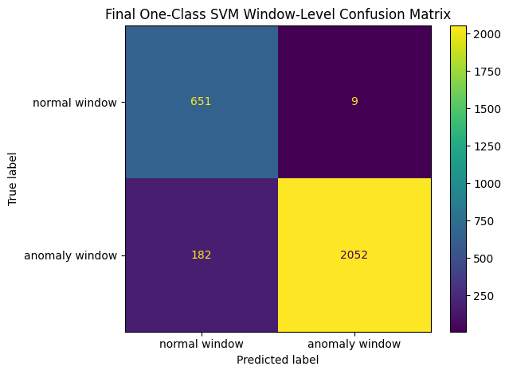
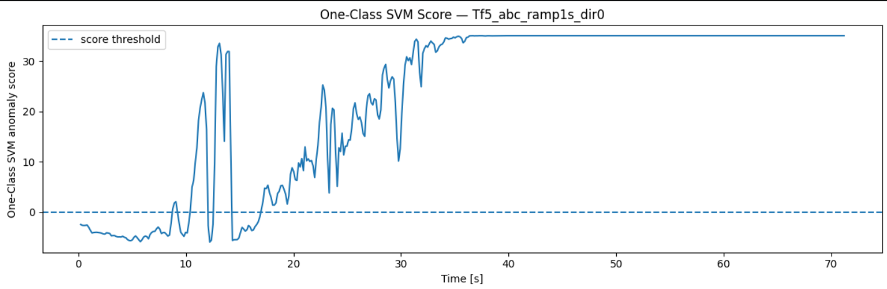
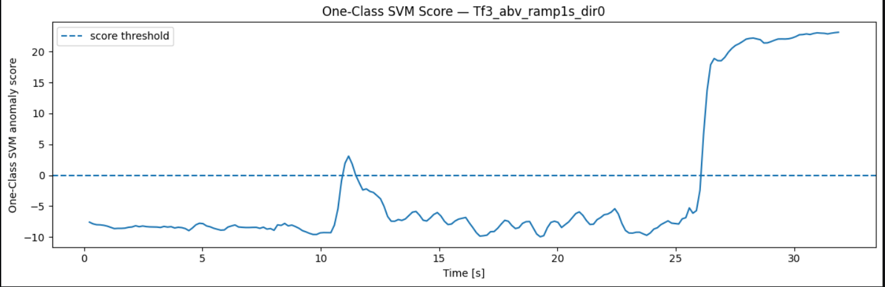
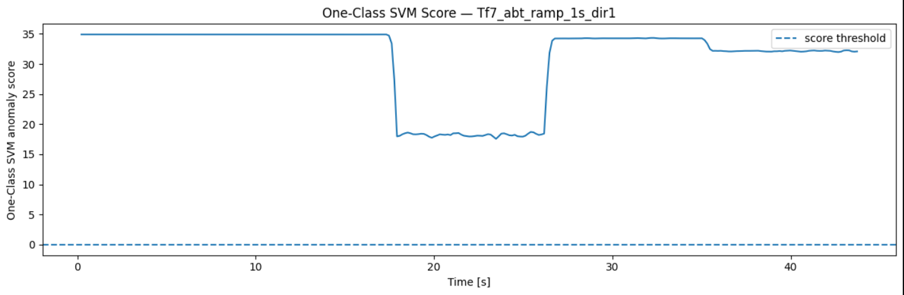

<!-- VIZ:START (generated by tools/build_readme_visuals.py, do not edit by hand) -->
# One-Class SVM

**Rank 18 of 22** by test score · Anomaly detection · runs on the STM32H573 · [← all models](../../README.md#all-models)

<picture><source media="(prefers-color-scheme: dark)" srcset="../../assets/viz/rows/13-dark.svg"></picture>

| Test score | CV macro F1 | Fault detection | False alarms | Inference (STM32H573) | Flash | RAM | MACC | Training time |
|---:|---:|---:|---:|---:|---:|---:|---:|---:|
| 86.0% | 92.2% | 72.6% | 0.7% | 2.160 ms | 233.11 KiB | 2.86 KiB | 107,511 | 1.7 s |

Test score = balanced accuracy of fault vs. no-fault on 7 unseen test recordings (mean of fault detection rate and 1 − false alarm rate).

### At a glance

<picture><source media="(prefers-color-scheme: dark)" srcset="../../assets/viz/model_cards/13-dark.svg"></picture>

**Model:** RBF kernel, small ν, trained on normal data only

> Almost no false alarms, but misses 27% of faults and needs 233 KiB of flash.

### Code

- [`one_class_svm.ipynb`](one_class_svm.ipynb)

### Architecture

### Results from the notebook

Cross-validation and training plots from the notebook.

### Tests on the fault recordings

The model on the three fault recordings: Tf3 mechanical fault, Tf5 electrical fault and Tf7 thermal fault (named in each plot title).

<!-- VIZ:END -->
