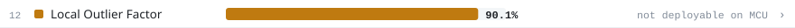
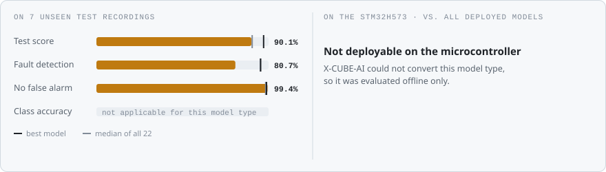
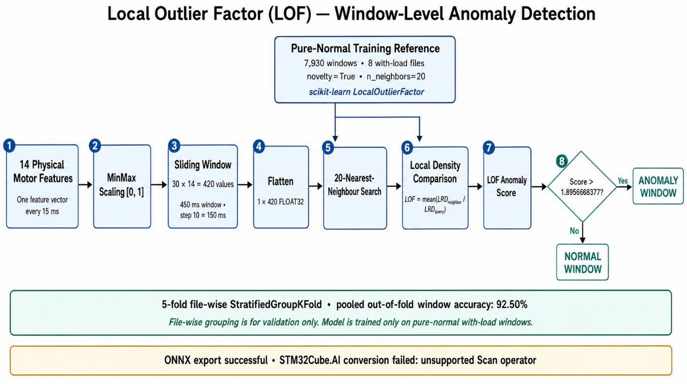
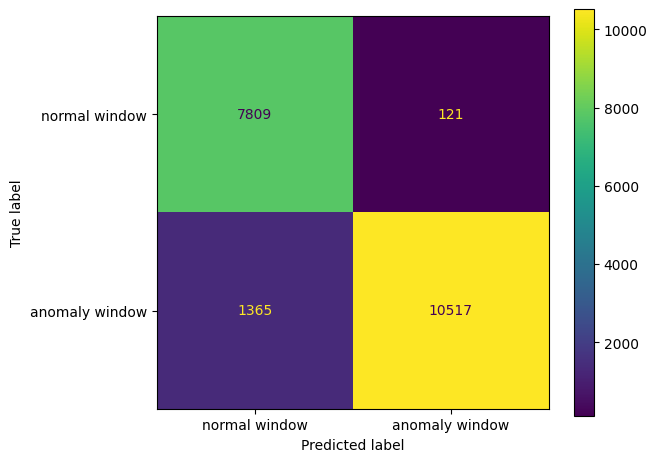
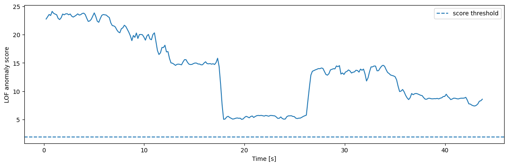
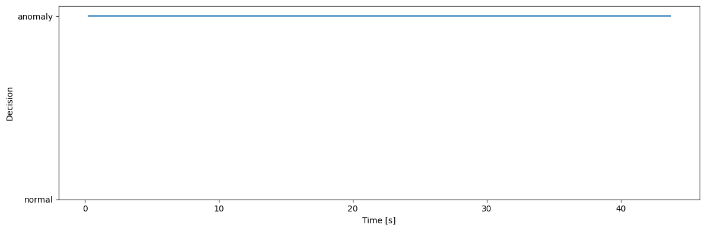
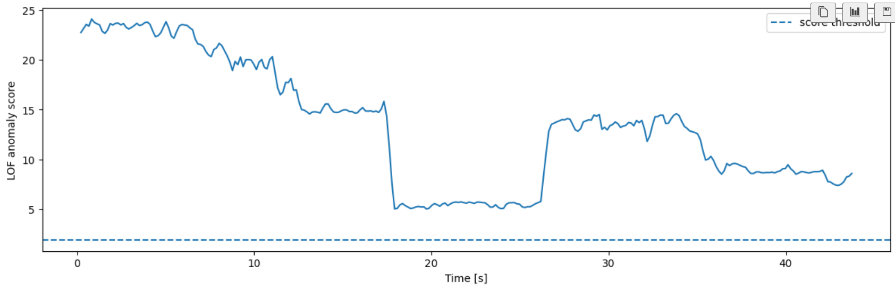
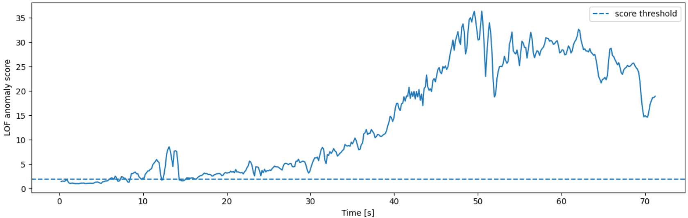
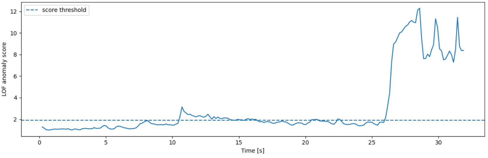

<!-- VIZ:START (generated by tools/build_readme_visuals.py, do not edit by hand) -->
# Local Outlier Factor

**Rank 12 of 22** by test score · Anomaly detection · **not deployable on the MCU** · [← all models](../../README.md#all-models)

<picture><source media="(prefers-color-scheme: dark)" srcset="../../assets/viz/rows/14-dark.svg"></picture>

| Test score | CV macro F1 | Fault detection | False alarms |
|---:|---:|---:|---:|
| 90.1% | 93.4% | 80.7% | 0.6% |

Test score = balanced accuracy of fault vs. no-fault on 7 unseen test recordings (mean of fault detection rate and 1 − false alarm rate).

### At a glance

<picture><source media="(prefers-color-scheme: dark)" srcset="../../assets/viz/model_cards/14-dark.svg"></picture>

**Model:** Density-based, novelty mode, trained on normal data only

> Cannot be converted for the MCU (13 MiB model and an unsupported scan operation).

### Code

- [`local_outlier_factor.ipynb`](local_outlier_factor.ipynb)

### Architecture

### Results from the notebook

Cross-validation and training plots, and the notebook's manual test on one example recording (named in the plot title).

### Tests on the fault recordings

The model on the three fault recordings: Tf3 mechanical fault, Tf5 electrical fault and Tf7 thermal fault (named in each plot title).

<!-- VIZ:END -->
