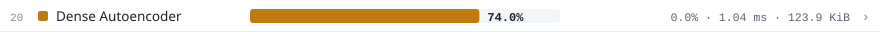
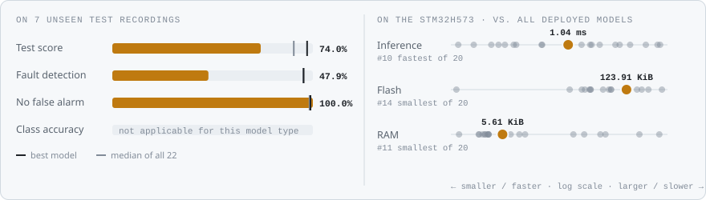
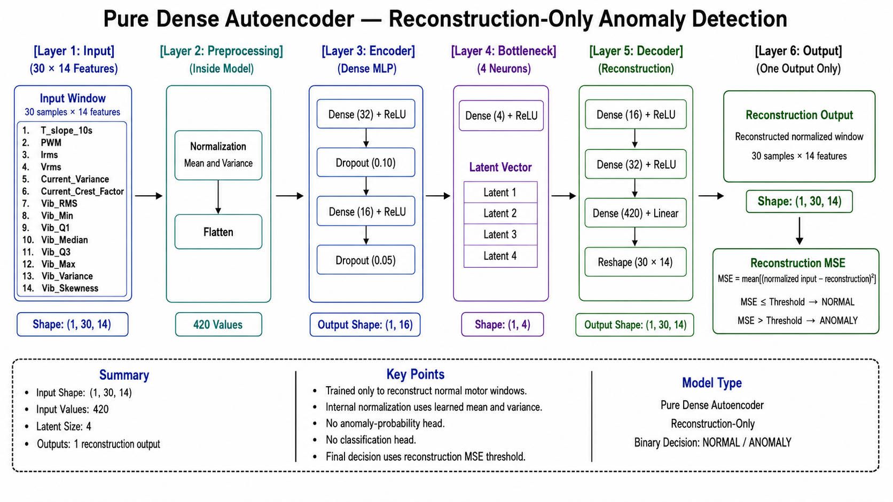
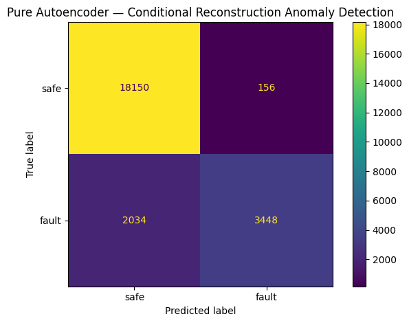
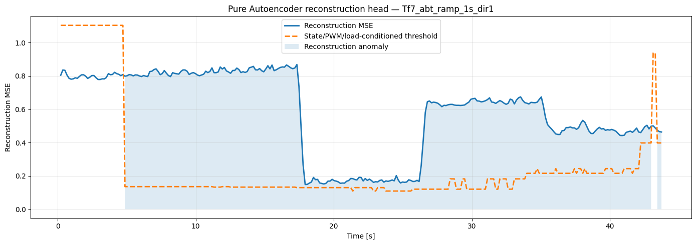
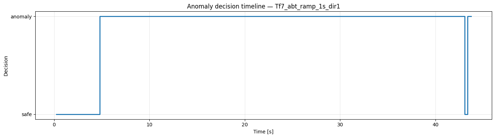
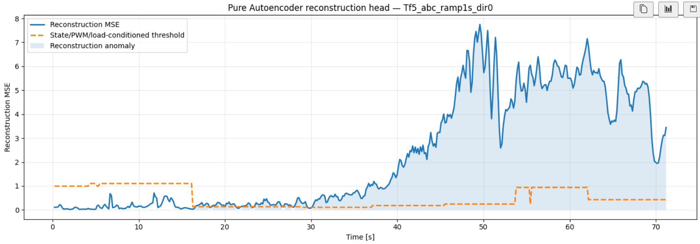
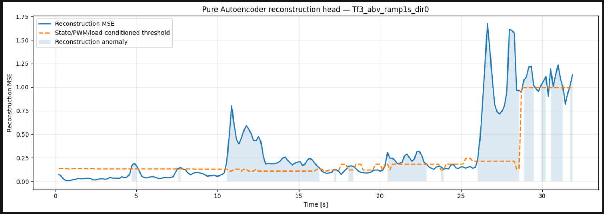
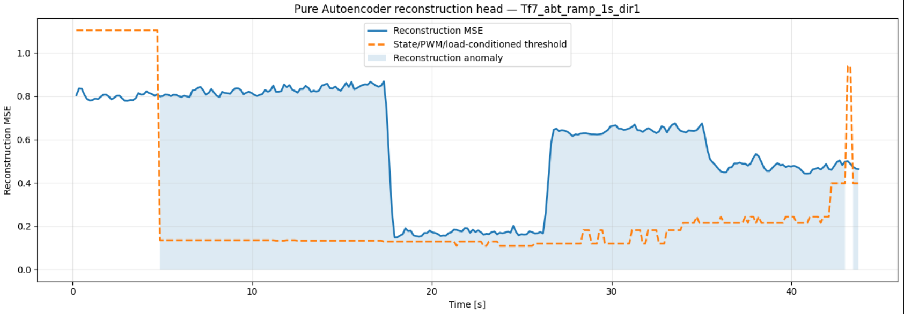

<!-- VIZ:START (generated by tools/build_readme_visuals.py, do not edit by hand) -->
# Dense Autoencoder

**Rank 20 of 22** by test score · Anomaly detection · runs on the STM32H573 · [← all models](../../README.md#all-models)

<picture><source media="(prefers-color-scheme: dark)" srcset="../../assets/viz/rows/15-dark.svg"></picture>

| Test score | CV macro F1 | Fault detection | False alarms | Inference (STM32H573) | Flash | RAM | MACC | Training time |
|---:|---:|---:|---:|---:|---:|---:|---:|---:|
| 74.0% | 91.4% | 47.9% | 0.0% | 1.040 ms | 123.91 KiB | 5.61 KiB | 29,912 | 44.9 s |

Test score = balanced accuracy of fault vs. no-fault on 7 unseen test recordings (mean of fault detection rate and 1 − false alarm rate).

### At a glance

<picture><source media="(prefers-color-scheme: dark)" srcset="../../assets/viz/model_cards/15-dark.svg"></picture>

**Model:** Dense encoder–decoder; reconstruction error is the anomaly score

> Never raised a false alarm, but detects only 48% of the fault windows.

### Code

- [`dense_autoencoder.ipynb`](dense_autoencoder.ipynb)

### Architecture

### Results from the notebook

Cross-validation and training plots, and the notebook's manual test on one example recording (named in the plot title).

### Tests on the fault recordings

The model on the three fault recordings: Tf3 mechanical fault, Tf5 electrical fault and Tf7 thermal fault (named in each plot title).

<!-- VIZ:END -->
