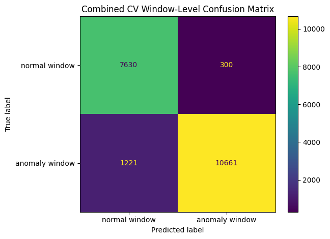
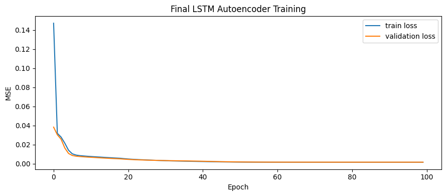
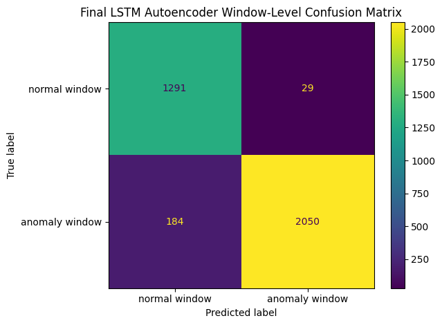
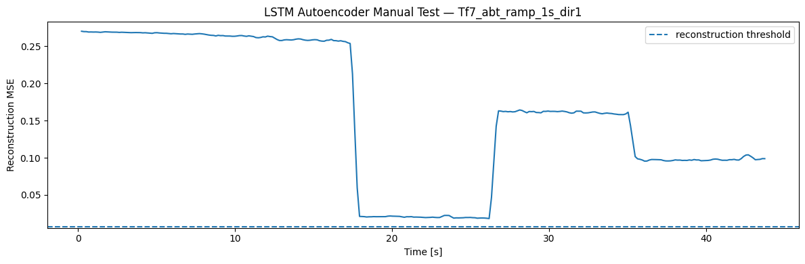
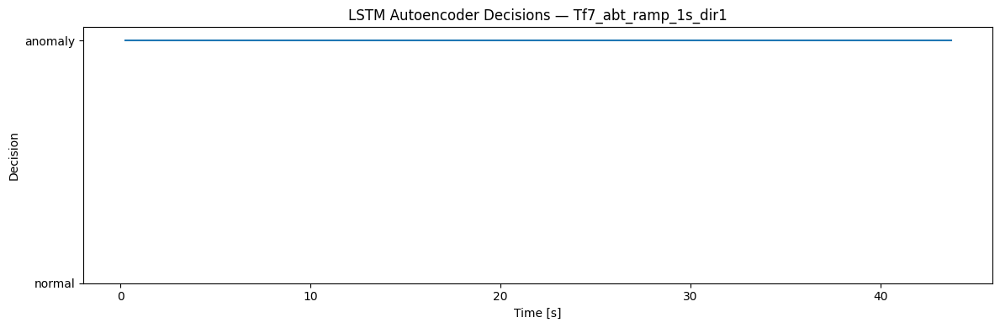

<!-- VIZ:START (generated by tools/build_readme_visuals.py, do not edit by hand) -->
# LSTM Autoencoder

**Rank 14 of 22** by test score · Anomaly detection · runs on the STM32H573 · [← all models](../../README.md#all-models)

<picture><source media="(prefers-color-scheme: dark)" srcset="../../assets/viz/rows/16-dark.svg"></picture>

| Test score | CV macro F1 | Fault detection | False alarms | Inference (STM32H573) | Flash | RAM | MACC | Training time |
|---:|---:|---:|---:|---:|---:|---:|---:|---:|
| 90.0% | 93.3% | 81.3% | 1.3% | 7.149 ms | 306.53 KiB | 268.00 KiB | 82,280 | 194.1 s |

Test score = balanced accuracy of fault vs. no-fault on 7 unseen test recordings (mean of fault detection rate and 1 − false alarm rate).

**Model:** LSTM encoder–decoder over 30 time steps

> Good offline, but needs 268 KiB of RAM on the MCU.

### Code

- [`lstm_autoencoder.ipynb`](lstm_autoencoder.ipynb)

### Results

<!-- VIZ:END -->
