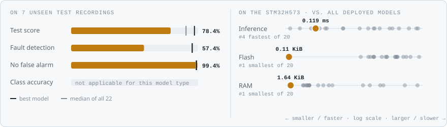
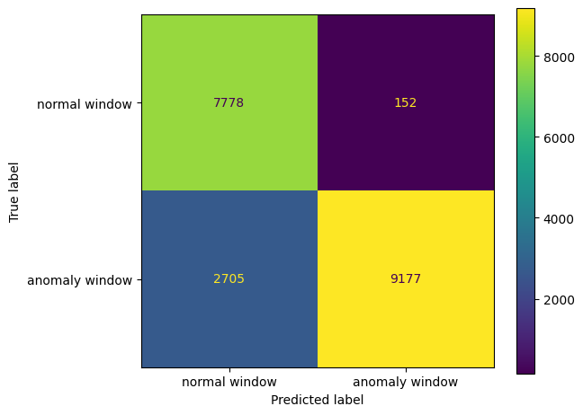
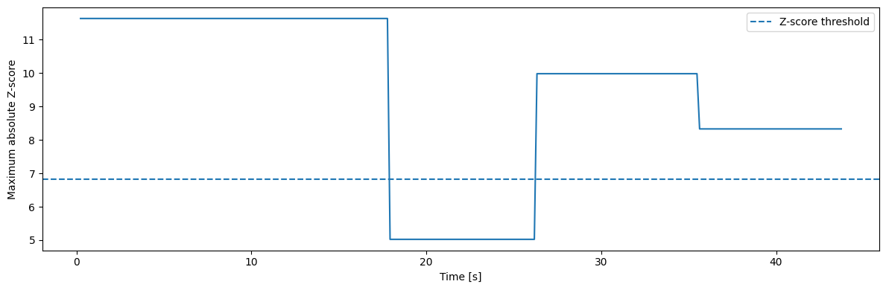
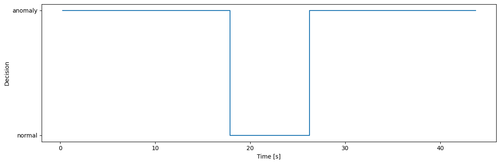

<!-- VIZ:START (generated by tools/build_readme_visuals.py, do not edit by hand) -->
# Z-score baseline

**Rank 19 of 22** by test score · Anomaly detection · runs on the STM32H573 · [← all models](../../README.md#all-models)

<picture><source media="(prefers-color-scheme: dark)" srcset="../../assets/viz/rows/17-dark.svg"></picture>

| Test score | CV macro F1 | Fault detection | False alarms | Inference (STM32H573) | Flash | RAM |
|---:|---:|---:|---:|---:|---:|---:|
| 78.4% | 86.5% | 57.4% | 0.6% | 0.119 ms | 0.11 KiB | 1.64 KiB |

Test score = balanced accuracy of fault vs. no-fault on 7 unseen test recordings (mean of fault detection rate and 1 − false alarm rate).

### At a glance

<picture><source media="(prefers-color-scheme: dark)" srcset="../../assets/viz/model_cards/17-dark.svg"></picture>

**Model:** Per-feature mean and std from normal data, plain C

> The sanity floor: plain C, 0.12 ms, detects 57% of the fault windows.

### Code

- [`zscore_baseline.ipynb`](zscore_baseline.ipynb)

### Results from the notebook

Cross-validation and training plots, plus the notebook's manual test. The manual test plots one example recording at a time (picked in a file dialog), so they show a single condition, often the thermal-fault recording. Scores across all 7 test recordings are in the chart above.

<!-- VIZ:END -->
