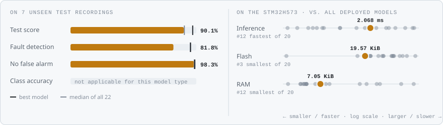
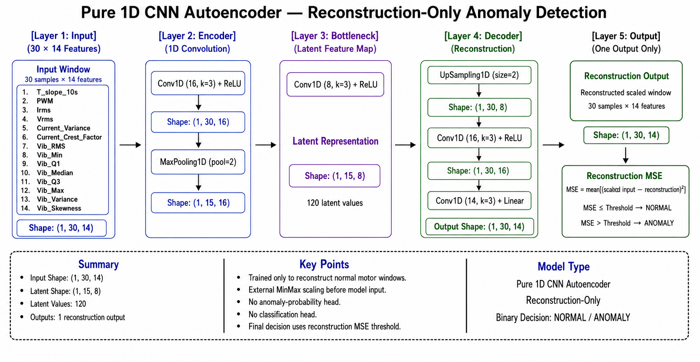
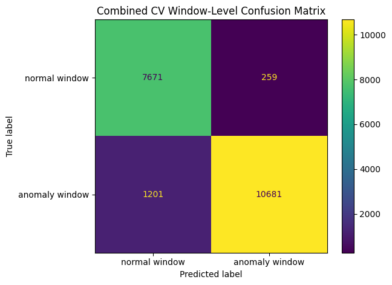
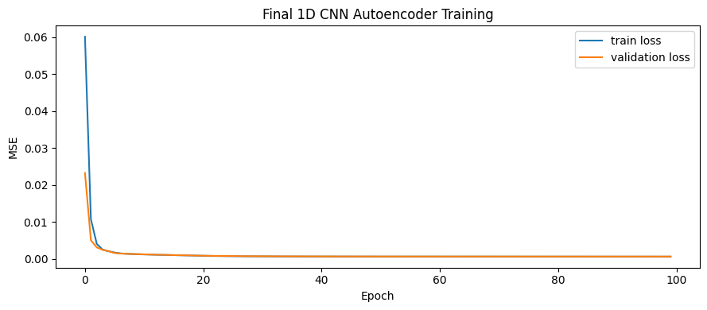
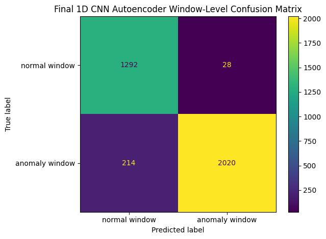
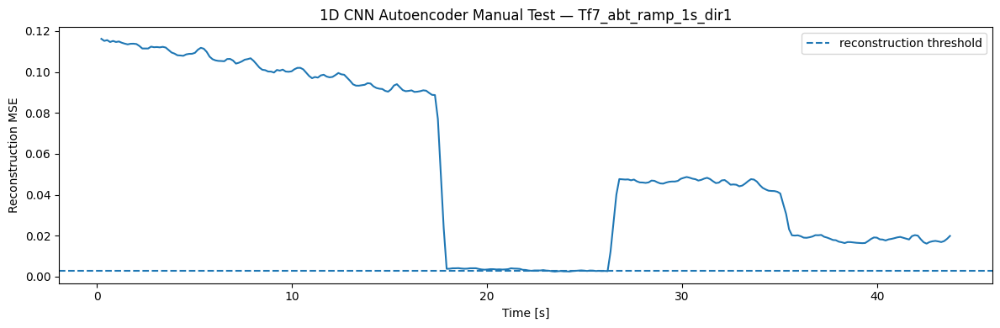
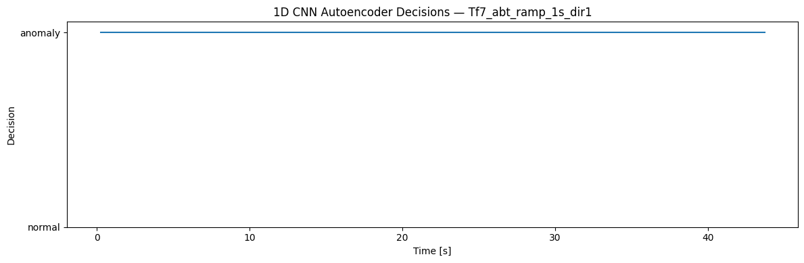

<!-- VIZ:START (generated by tools/build_readme_visuals.py, do not edit by hand) -->
# 1D-CNN Autoencoder

**Rank 13 of 22** by test score · Anomaly detection · runs on the STM32H573 · [← all models](../../README.md#all-models)

<picture><source media="(prefers-color-scheme: dark)" srcset="../../assets/viz/rows/18-dark.svg"></picture>

| Test score | CV macro F1 | Fault detection | False alarms | Inference (STM32H573) | Flash | RAM | MACC | Training time |
|---:|---:|---:|---:|---:|---:|---:|---:|---:|
| 90.1% | 93.6% | 81.8% | 1.7% | 2.068 ms | 19.57 KiB | 7.05 KiB | 59,214 | 61.8 s |

Test score = balanced accuracy of fault vs. no-fault on 7 unseen test recordings (mean of fault detection rate and 1 − false alarm rate).

### At a glance

<picture><source media="(prefers-color-scheme: dark)" srcset="../../assets/viz/model_cards/18-dark.svg"></picture>

**Model:** 1D-CNN encoder–decoder

> The best unsupervised detector (81.8% of faults) in only 20 KiB of flash.

### Code

- [`cnn_autoencoder.ipynb`](cnn_autoencoder.ipynb)

### Architecture

### Results from the notebook

Cross-validation and training plots from the notebook.

<!-- VIZ:END -->
