<!-- VIZ:START (generated by tools/build_readme_visuals.py, do not edit by hand) -->
# MLP hybrid (multi-task)

**Rank 1 of 22** by test score · Hybrid multi-task · runs on the STM32H573 · [← all models](../../README.md#all-models)

<picture><source media="(prefers-color-scheme: dark)" srcset="../../assets/viz/rows/19-dark.svg"></picture>

| Test score | CV macro F1 | Fault detection | False alarms | Class accuracy | Inference (STM32H573) | Flash | RAM | MACC | Training time |
|---:|---:|---:|---:|---:|---:|---:|---:|---:|---:|
| 97.1% | 96.7% | 95.4% | 1.2% | 97.0% | 1.576 ms | 191.56 KiB | 10.59 KiB | 46,025 | 31.0 s |

Test score = balanced accuracy of fault vs. no-fault on 7 unseen test recordings (mean of fault detection rate and 1 − false alarm rate).

### At a glance

<picture><source media="(prefers-color-scheme: dark)" srcset="../../assets/viz/model_cards/19-dark.svg">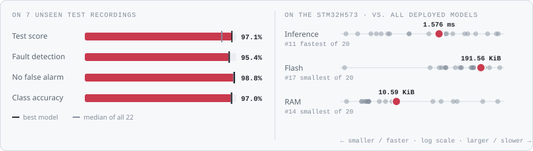</picture>

**Model:** Shared dense encoder → reconstruction + anomaly + 7-class heads

> Best overall and the model in the final firmware: 1.2% false alarms, 1.58 ms, 96.2% agreement in the live test.

### Code

- [`mlp_hybrid.ipynb`](mlp_hybrid.ipynb)

### Results from the notebook

Cross-validation and training plots, plus the notebook's manual test. The manual test plots one example recording at a time (picked in a file dialog), so they show a single condition, often the thermal-fault recording. Scores across all 7 test recordings are in the chart above.

<a href="figures/fig_01.png">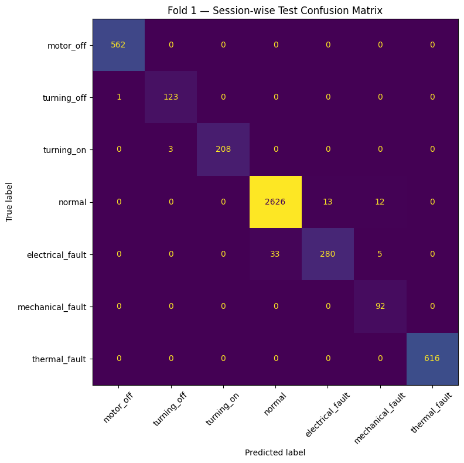</a>
<a href="figures/fig_02.png">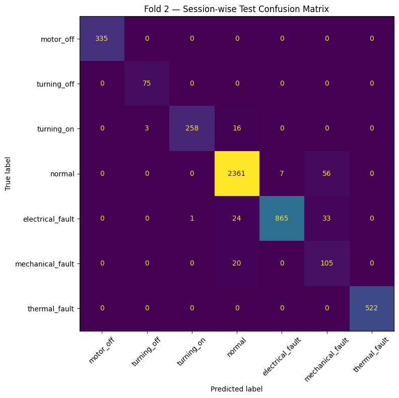</a>
<a href="figures/fig_03.png">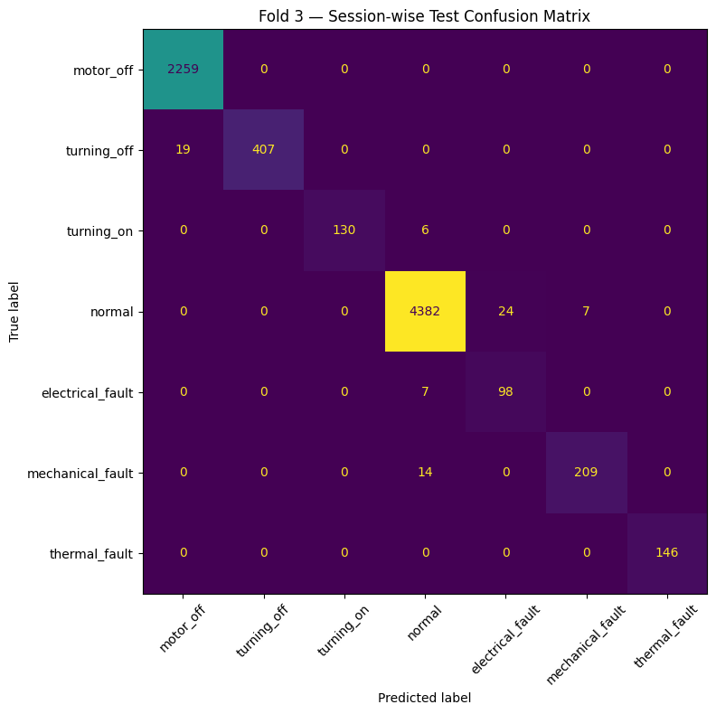</a>
<a href="figures/fig_04.png">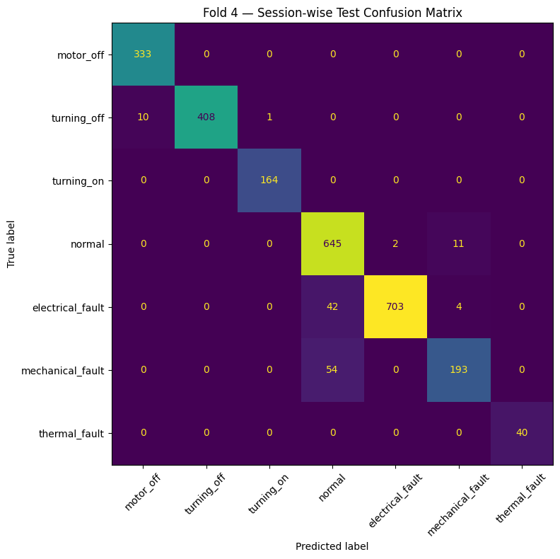</a>
<a href="figures/fig_05.png">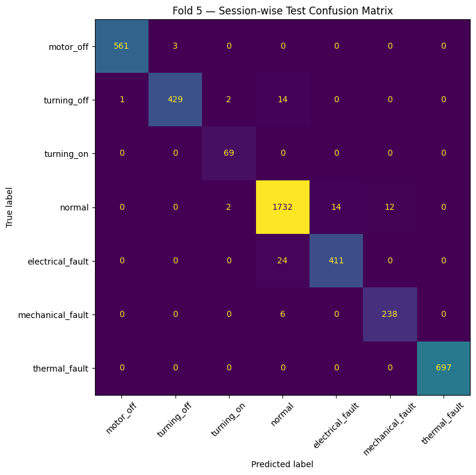</a>
<a href="figures/fig_06.png">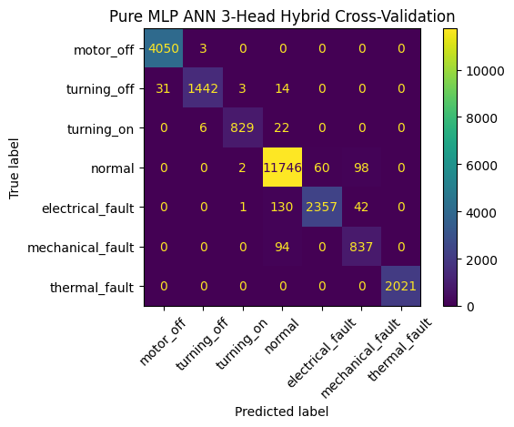</a>

More plots (14)

<a href="figures/fig_07.png">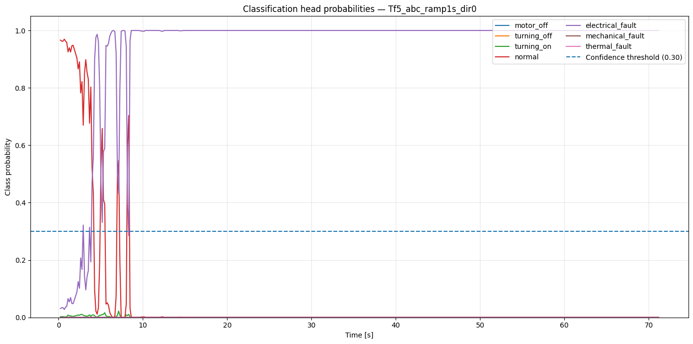</a>
<a href="figures/fig_08.png">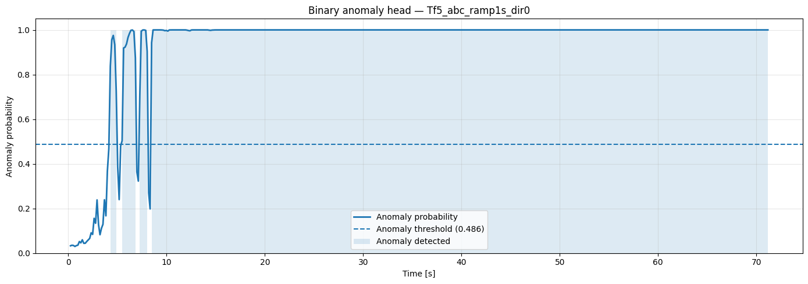</a>
<a href="figures/fig_09.png">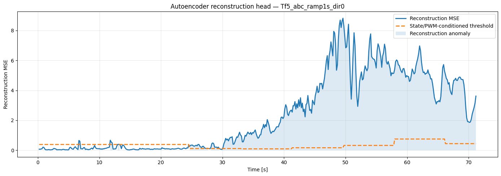</a>
<a href="figures/fig_10.png">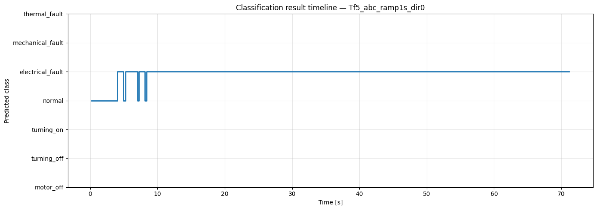</a>
<a href="figures/fig_11.png">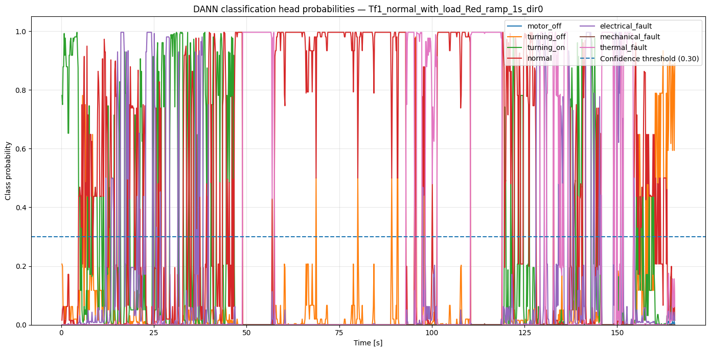</a>
<a href="figures/fig_12.png">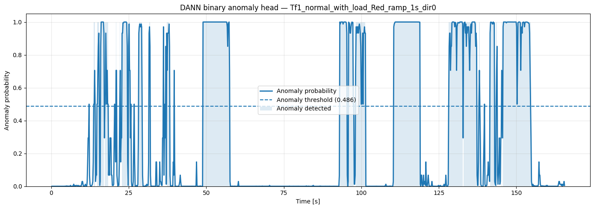</a>
<a href="figures/fig_13.png">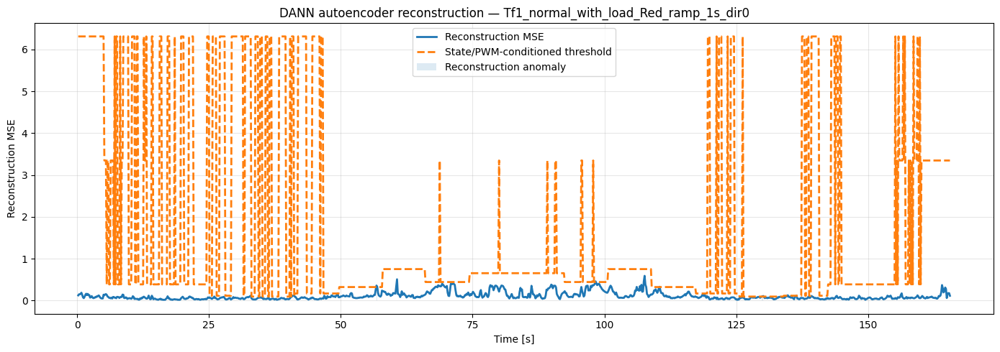</a>
<a href="figures/fig_14.png">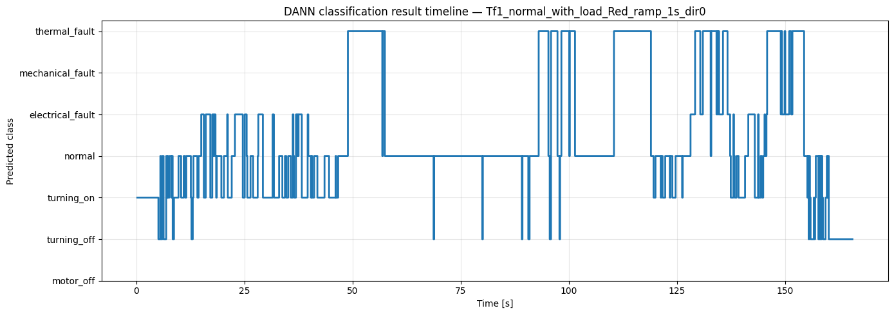</a>
<a href="figures/fig_15.png">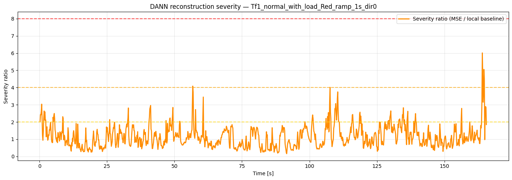</a>
<a href="figures/fig_16.png">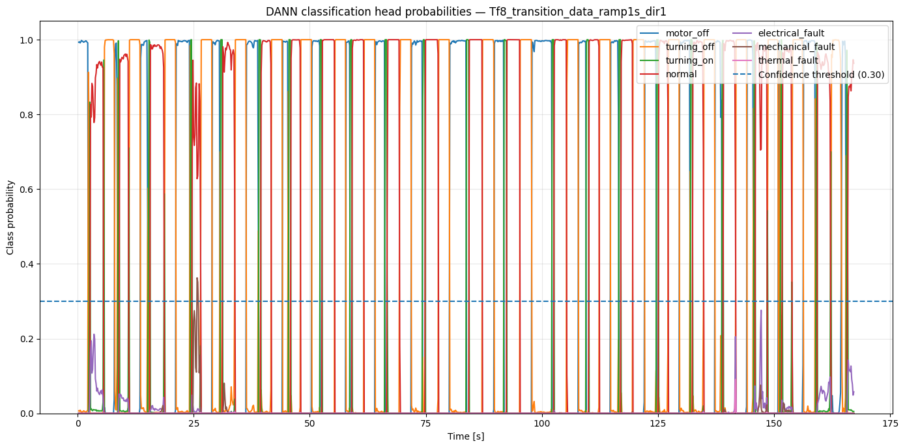</a>
<a href="figures/fig_17.png">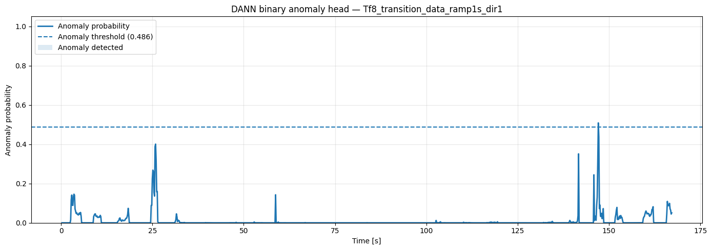</a>
<a href="figures/fig_18.png">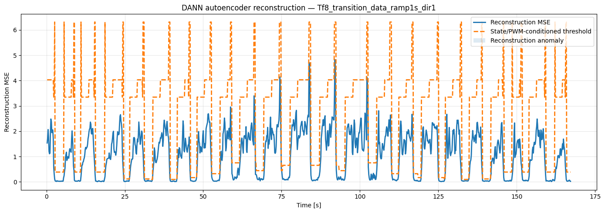</a>
<a href="figures/fig_19.png">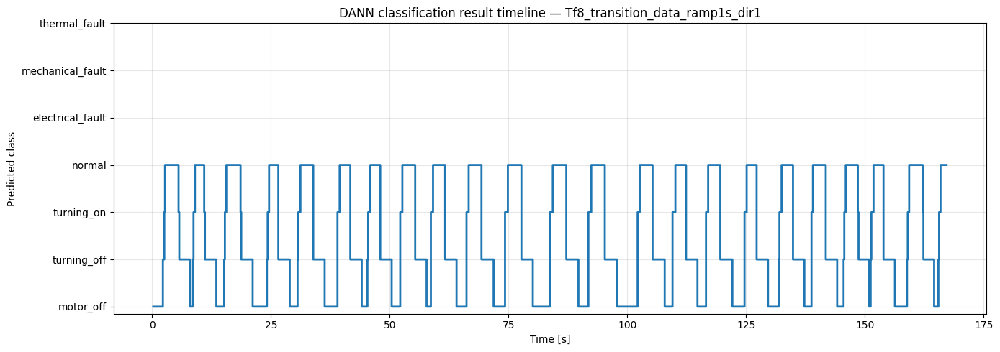</a>
<a href="figures/fig_20.png">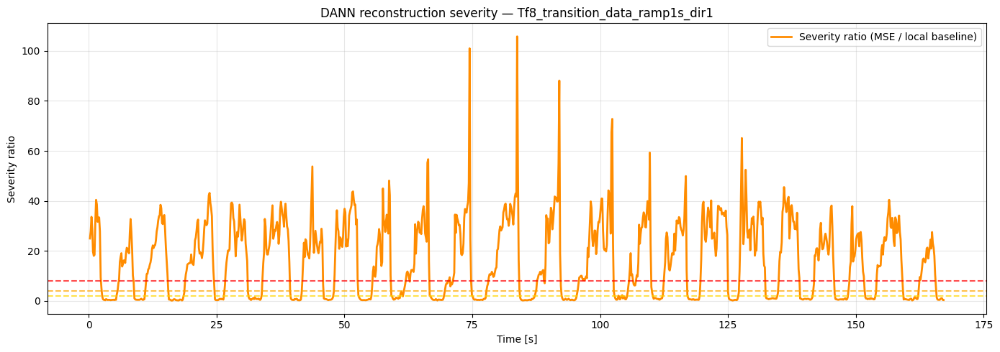</a>

<!-- VIZ:END -->
