<!-- VIZ:START (generated by tools/build_readme_visuals.py, do not edit by hand) -->
# TCN hybrid

**Rank 4 of 22** by test score · Hybrid multi-task · runs on the STM32H573 · [← all models](../../README.md#all-models)

<picture><source media="(prefers-color-scheme: dark)" srcset="../../assets/viz/rows/20-dark.svg"></picture>

| Test score | CV macro F1 | Fault detection | False alarms | Class accuracy | Inference (STM32H573) | Flash | RAM | MACC | Training time |
|---:|---:|---:|---:|---:|---:|---:|---:|---:|---:|
| 96.6% | 91.8% | 96.7% | 3.6% | 97.5% | 16.793 ms | 111.48 KiB | 41.45 KiB | 453,509 | 55.0 s |

Test score = balanced accuracy of fault vs. no-fault on 7 unseen test recordings (mean of fault detection rate and 1 − false alarm rate).

### At a glance

<picture><source media="(prefers-color-scheme: dark)" srcset="../../assets/viz/model_cards/20-dark.svg">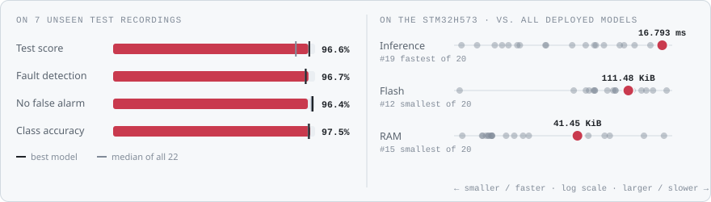</picture>

**Model:** Two causal residual TCN encoders, three heads

> 96.6% test score, but 16.8 ms per window and more false-alarm events live.

### Code

- [`tcn_hybrid.ipynb`](tcn_hybrid.ipynb)

### Results from the notebook

Cross-validation and training plots, plus the notebook's manual test. The manual test plots one example recording at a time (picked in a file dialog), so they show a single condition, often the thermal-fault recording. Scores across all 7 test recordings are in the chart above.

<a href="figures/fig_01.png">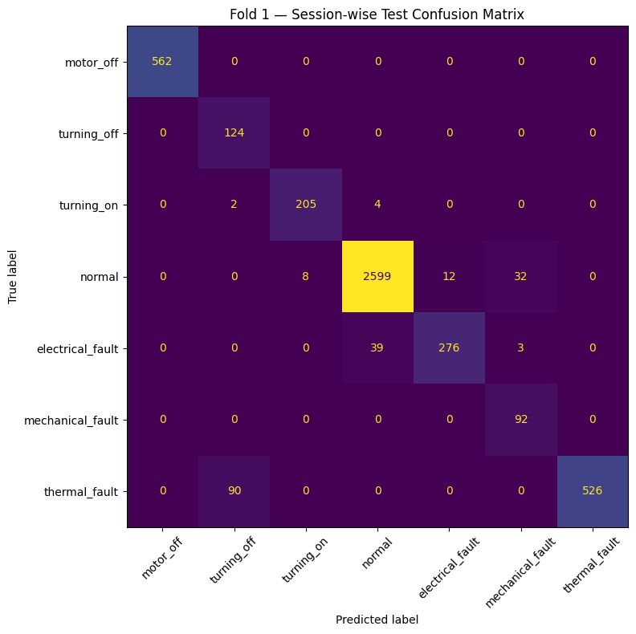</a>
<a href="figures/fig_02.png">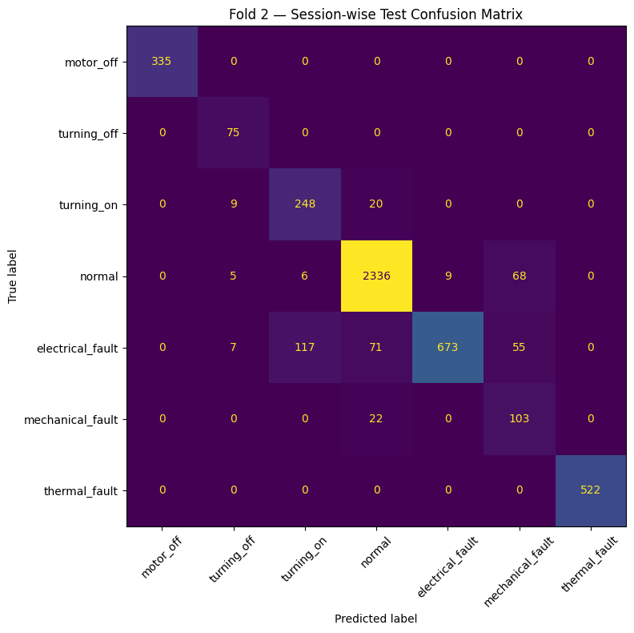</a>
<a href="figures/fig_03.png">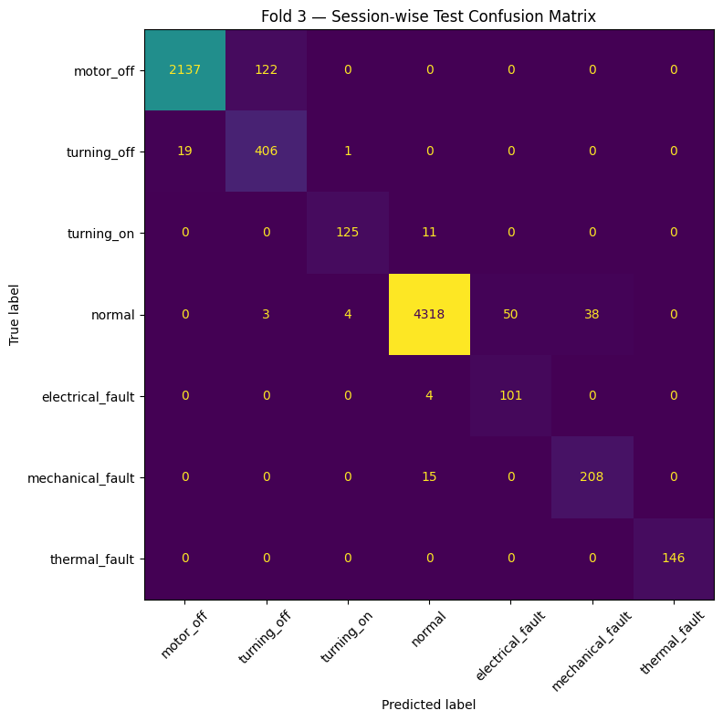</a>
<a href="figures/fig_04.png">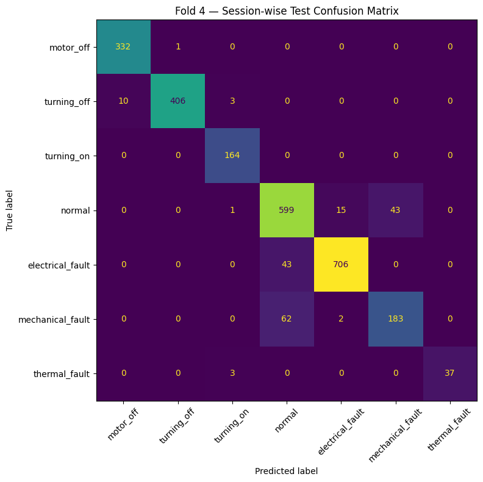</a>
<a href="figures/fig_05.png">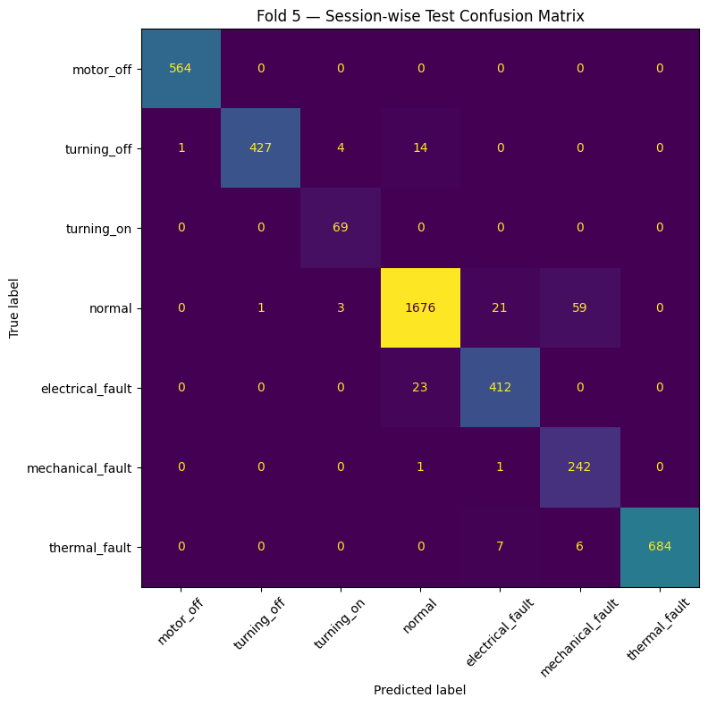</a>
<a href="figures/fig_06.png">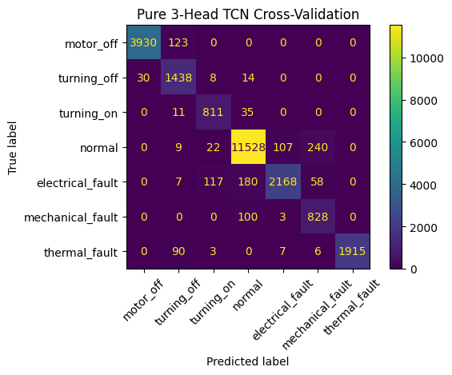</a>

More plots (10)

<a href="figures/fig_07.png">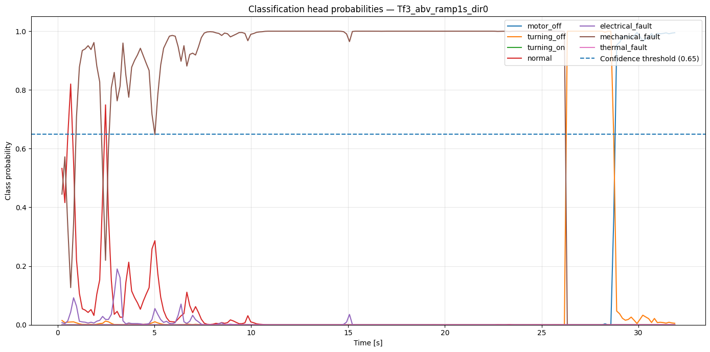</a>
<a href="figures/fig_08.png">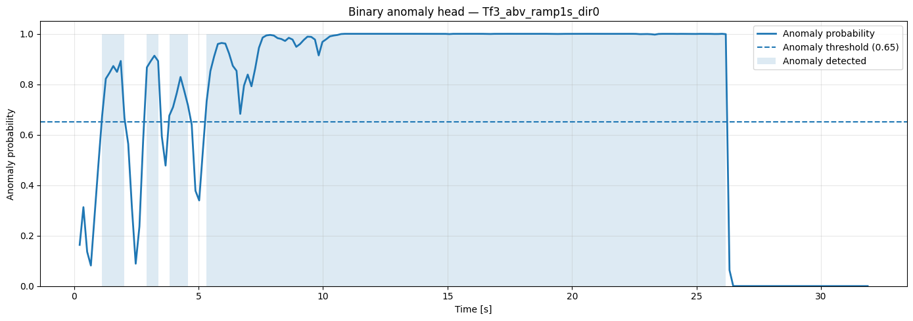</a>
<a href="figures/fig_09.png">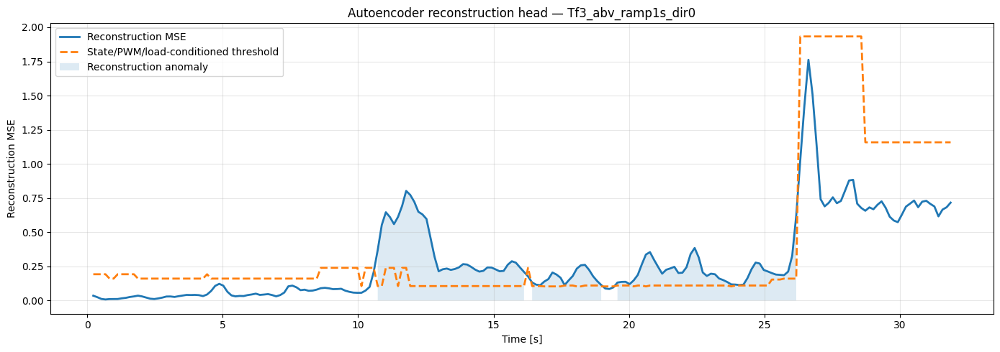</a>
<a href="figures/fig_10.png">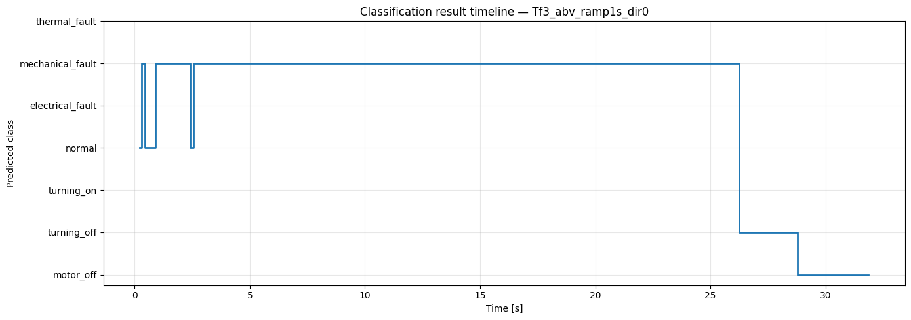</a>
<a href="figures/fig_11.png">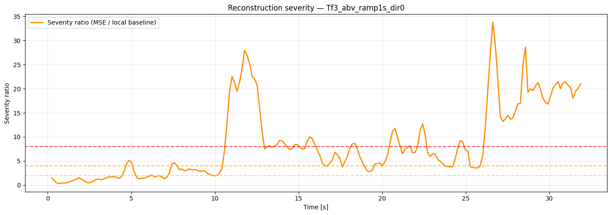</a>
<a href="figures/fig_12.png">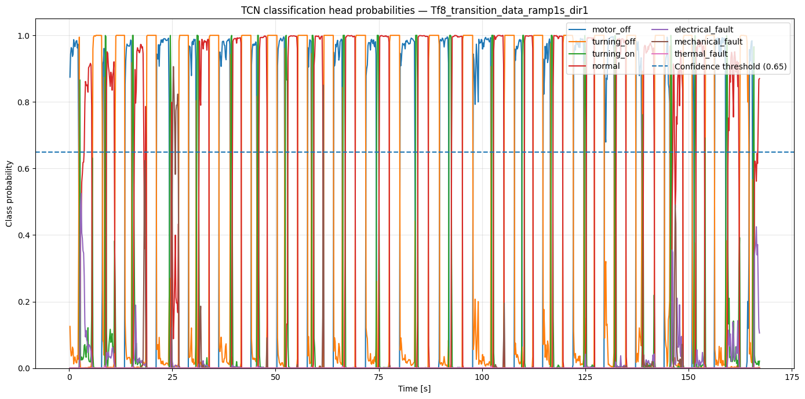</a>
<a href="figures/fig_13.png">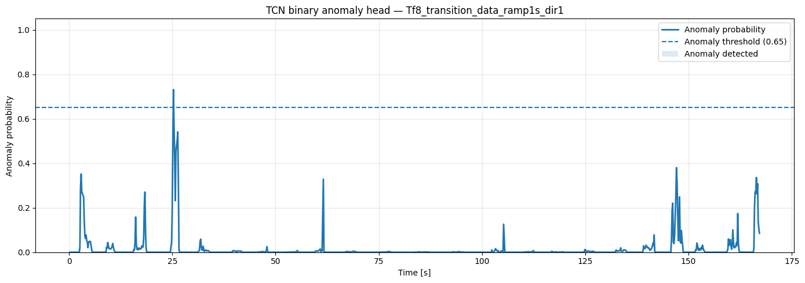</a>
<a href="figures/fig_14.png">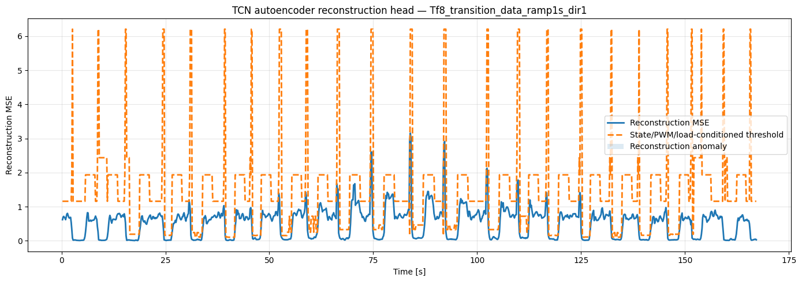</a>
<a href="figures/fig_15.png">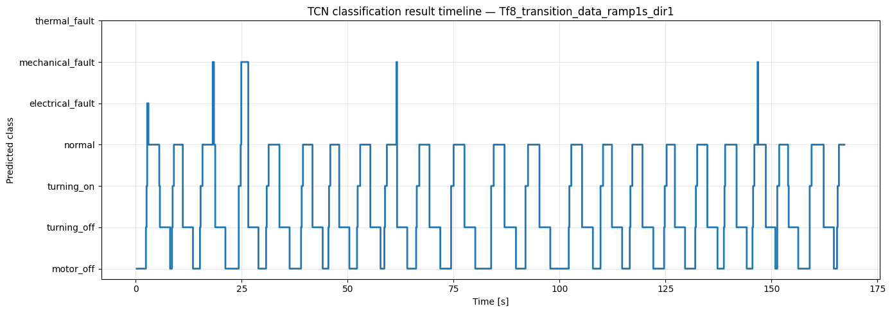</a>
<a href="figures/fig_16.png">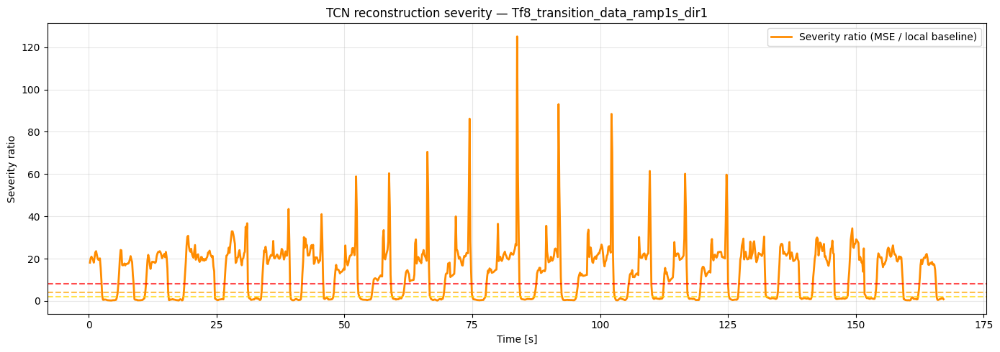</a>

<!-- VIZ:END -->
